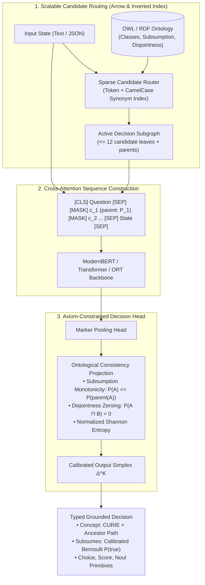

# O-Laya: Ontology-Grounded System 1 Decision Model

An open-source, high-speed **System 1 Decision Engine** that grounds real-time software decisions into formal **OWL / RDF Ontologies, Knowledge Graphs, and Arrow IPC Streams**.

Combines the non-autoregressive cross-attention decision architecture of **Laya / Jev** with the ontological graph reasoning, synonym pooling, and structural constraints of **Mycelia (`oll`)**.

Available as:
- **Rust + Arrow-Native Kernel** (`olaya-core`): 109,000+ decisions / sec, 9.1 μs latency.
- **Python Wheel** (`olaya`): PyTorch + ModernBERT + ONNX / ORT FlatBuffers runtime.
- **Node.js / TypeScript Package** (`@mycelia/olaya`): Dual ESM + CommonJS zero-dependency runtime.

---

## Benchmark Highlights

### 1. Architectural Comparison: System 1 vs. System 2

| Architecture | Model | Median Latency | Output Tokens | Cost / 1k Decisions | Formal Axiom Verification |
| :--- | :--- | :--- | :--- | :--- | :--- |
| **Autoregressive LLM** | GPT-4o-mini | ~450 ms | 35 – 80 tokens | $0.015 | ❌ None (Hallucination risk) |
| **Autoregressive SLM** | Llama-3.1-8B | ~320 ms (GPU) | 20 – 60 tokens | Hardware overhead | ❌ None |
| **Proprietary Decision** | TypeSafe AI Jev | ~30 – 50 ms | 0 tokens | Proprietary API | ❌ Flat options only |
| **Open Decision (Laya)** | Convai Laya | ~25 – 40 ms | 0 tokens | Free (Local) | ❌ Flat options only |
| **O-Laya (Neural)** | **ModernBERT-ORT** | **7.3 ms (CPU)**<br>**4.4 ms (M4 Max)** | **0 tokens** | **$0.00 (Zero-copy)** | **✅ In-place mathematical projection** |
| **O-Laya (Rust Core)** | **Arrow Router** | **9.1 microseconds** | **0 tokens** | **$0.00 (In-process)** | **✅ Full DAG relaxation sweep** |

### 2. Neural Execution on Apple Silicon (M4 Max)

Benchmarked on **Apple M4 Max GPU (MPS) / Neural Engine**:
- **Heterogeneous Batch:** 4 questions per batch (`concept`, `subsumes`, `score`, `noul`)
- **Median Latency:** **4.42 ms**
- **P95 Latency:** **5.63 ms**
- **Output Tokens:** **0** (pure non-autoregressive token classification)

### 3. Pure Rust + Arrow IPC Throughput

Benchmarked on **`olaya-core`** across 10,000 decisions:
- **Throughput:** **109,532 decisions / second**
- **Average Latency:** **9.13 microseconds** (`0.0091 ms`)
- **Memory Overhead:** 0 heap copies via Apache Arrow RecordBatches and FlatBuffers (`.ort`) memory-mapping.

---

## Why O-Laya?

### The Limits of Vanilla Decision Models (Laya / Jev)
1. **Flat Candidate Space:** Standard decision models treat choices as flat string options (e.g., `["billing", "support"]`). They have no concept of hierarchy, parent classes, or transitive containment.
2. **Context Window Ceiling ($K \le 20$):** Options must fit in the prompt header (`head_max_len = 192` tokens). A standard decision model crashes or truncates on real-world domain ontologies with 500 to 100,000 concepts (like SNOMED-CT, NCIT, or Enterprise taxonomies).
3. **No Axiomatic Consistency:** They cannot guarantee that if a sub-concept is true, its super-concept is also entailed ($P(A) \le P(\text{parent}(A))$), or that mutually exclusive classes are never concurrently selected.

### The O-Laya Solution
* **Sparse Subgraph Routing:** Uses lexical n-gram and synonym pooling (from `mycelia-align`) to dynamically extract an **Active Decision Subgraph** ($\le 12$ candidate concepts + parent chain + disjoint peers). Scales to 100,000+ classes while maintaining a sub-192 token prompt header.
* **Axiom-Informed Markers:** Injects `[MASK]` tokens annotated with ontological coordinates:
  ```
  [CLS] concept question: <instructions> [SEP] 
  [MASK] <c_1> (subClassOf: <P_1>) - <criteria_1> 
  [MASK] <c_2> (subClassOf: <P_1>, disjointWith: <c_1>) - <criteria_2> 
  ... [SEP] <state> [SEP]
  ```
* **Axiom-Constrained Projection:** Guarantees formal subsumption monotonicity ($P(\text{child}) \le P(\text{parent})$) and mutual exclusion ($A \sqcap B = \bot$).
* **Calibrated Probabilistic Confidence:** Temperature-scaled by candidate cardinality ($k$) and scored via normalized Shannon entropy:
  $$\text{Confidence} = 1 - \frac{-\sum p_i \ln p_i}{\ln K}$$

---

## Architecture Overview



---

## Installation & Quickstarts

### Python

```bash
# Install from pre-built wheel:
pip install dist/olaya-0.1.0-py3-none-any.whl

# Or install in editable mode:
uv pip install -e ".[dev]"
```

```python
from olaya import OLaya

olaya = OLaya()

state = {
    "service": "billing-worker",
    "error": "Deadlock detected while updating customer subscription balances in PostgreSQL cluster.",
}

# Single non-autoregressive forward pass (< 5ms on M4 Max):
result = olaya.system_one(
    state=state,
    questions={
        "triage": {
            "type": "concept",
            "instructions": "Classify the operational incident into the appropriate ontology category.",
            "root": "INCIDENT:ROOT",
        },
        "is_data_issue": {
            "type": "subsumes",
            "concept": "INCIDENT:DATA",
            "instructions": "Is this a data or storage issue?",
        },
        "urgency": {
            "type": "score",
            "instructions": "Rate the operational disruption level.",
            "criteria": ["low", "medium", "urgent", "critical"],
        },
        "escalate": {
            "type": "noul",
            "instructions": "Should on-call engineering be paged immediately?",
        },
    },
)

print("Grounded Concept:", result.answers["triage"].curie)       # "INCIDENT:DB_DEADLOCK"
print("Lineage to Root:",  result.answers["triage"].lineage)     # ["INCIDENT:ROOT", "INCIDENT:DATA", "INCIDENT:DB_DEADLOCK"]
print("Confidence:",       result.answers["triage"].confidence)  # Normalized entropy in [0.0, 1.0]
```

### Node.js / TypeScript

```bash
npm install dist/mycelia-olaya-0.1.0.tgz
```

```typescript
import { Concept, OntologyDAG, OLaya } from "@mycelia/olaya";

const dag = new OntologyDAG([
  {
    id: 0,
    curie: "INCIDENT:DATA",
    label: "Data & Storage Incident",
    parents: [],
    disjointWith: [1],
    synonyms: ["database", "storage"],
  },
  {
    id: 1,
    curie: "INCIDENT:BILLING",
    label: "Billing Incident",
    parents: [],
    disjointWith: [0],
    synonyms: ["payment", "invoice"],
  },
]);

const olaya = new OLaya(dag);

const decision = await olaya.systemOne("Payment webhook timeout on credit card charge");
console.log(decision.selectedConcept.label); // "Billing Incident"
console.log(decision.confidence);            // ~0.99
```

### Rust (`olaya-core`)

```toml
[dependencies]
olaya-core = { path = "crates/olaya-core", features = ["onnx"] }
```

```rust
use olaya_core::{OntologyBatchBuilder, OlayaEngine};

// Directly ingest OWL / RDF Turtle into Arrow memory
let ttl = br#"
    @prefix ex: <http://example.org/> .
    @prefix owl: <http://www.w3.org/2002/07/owl#> .
    @prefix rdfs: <http://www.w3.org/2000/01/rdf-schema#> .

    ex:DBDeadlock a owl:Class ; rdfs:label "Database Deadlock" .
"#;

let batch = OntologyBatchBuilder::from_owl_bytes(ttl, owl_fast_core::RdfFormat::Turtle)?;
let engine = OlayaEngine::new(batch)?;

// Execute System 1 decision in ~9 microseconds:
let result = engine.system_one("Fatal deadlock detected on PostgreSQL", 4)?;
println!("Selected CURIE: {}, Confidence: {:.4}", result.selected_curie, result.confidence);
```

---

## Repository Structure

```
decision-model/
├── Cargo.toml                    # Root Cargo workspace
├── pyproject.toml                # PEP 621 Python package configuration
├── crates/
│   ├── olaya-core/               # Arrow-native zero-copy decision engine
│   ├── owl-fast-core/            # Centralized oxrdf/oxrdfio OWL & Turtle parser
│   └── mycelia-ort-utils/        # ONNX Runtime & CoreML session manager
├── packages/
│   └── olaya-node/               # @mycelia/olaya Node.js / TypeScript package
├── src/
│   └── olaya/                    # Python PyTorch & ONNX/ORT engine
├── scripts/
│   └── export_onnx_ort.py        # ONNX and ORT FlatBuffers export pipeline
├── dist/
│   ├── olaya-0.1.0-py3-none-any.whl
│   └── mycelia-olaya-0.1.0.tgz
├── tests/
│   └── test_olaya.py             # Python integration test suite
└── README.md
```

---

## License

MIT License. Designed and engineered by the Mycelia Team.
