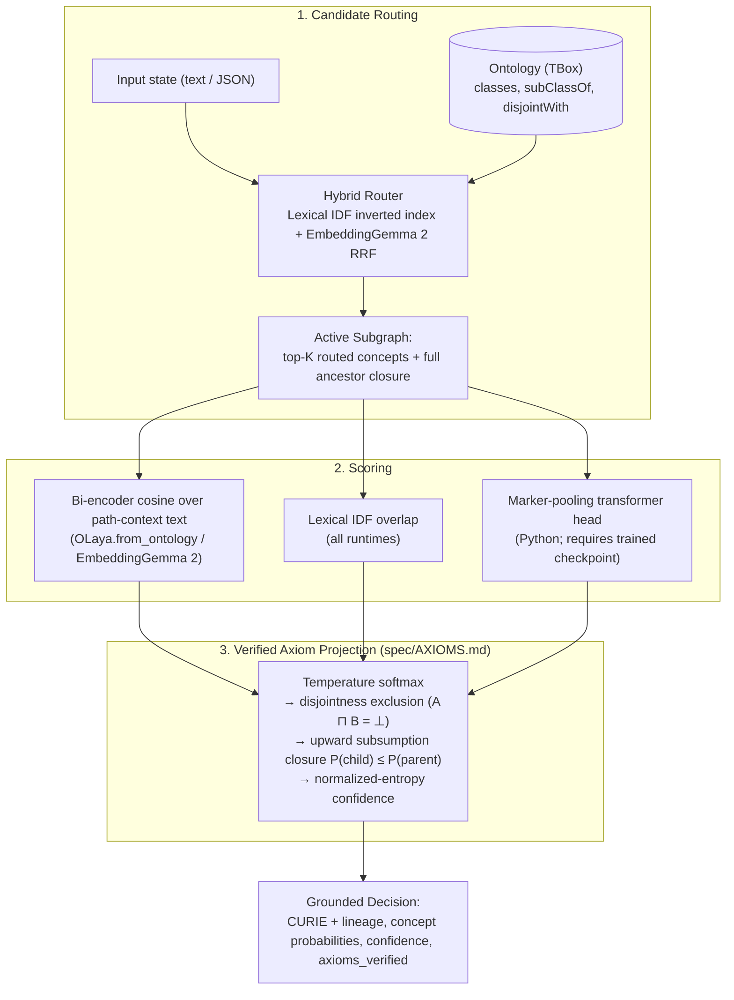

# O-Laya (`leio-decision`)

**Fast, ontology-grounded System 1 decisions for software and AI agents — backed by a Lean 4-verified axiom kernel.**

```bash
pip install leio-decision          # Pure stdlib base install
uvx leio-decision                  # Python MCP server (zero install)
npx leio-decision                  # Node.js MCP server (zero dependencies)
```

📄 **[Read the Technical Paper (`PAPER.md`)](PAPER.md)** · 🔬 **[Formal Axiom Spec (`spec/AXIOMS.md`)](spec/AXIOMS.md)** · 📐 **[OWL 2 RL Conformance (`spec/OWL2RL.md`)](spec/OWL2RL.md)**

---

## Why O-Laya?

Modern software pipelines and AI agents constantly make **System 1 decisions**: routing an incoming ticket or webhook, classifying a product SKU into a taxonomy, triaging an operational alert, gating a workflow branch, or tagging an enterprise table against a governance ontology.

Today, teams are forced to choose between two flawed options:

1. **Autoregressive LLMs for every classification:** Slow (500 ms–3 s), expensive at high throughput, non-deterministic across runs, prone to hallucinating class names outside your vocabulary, and blind to formal ontology constraints.
2. **Flat vector search / ad-hoc classifiers:** Fast, but return unconstrained cosine scores that violate class hierarchies ($P(\text{child}) > P(\text{parent})$), ignore mutual exclusions (`owl:disjointWith`), and offer no auditable provenance or replay guarantee.

**O-Laya bridges the gap.** You bring a formal ontology (`.ttl`, `.owl`, `.jsonld`, or `.json`). At runtime, O-Laya routes and scores observations in **8–180 ms on CPU** (using lexical IDF or `google/embeddinggemma-2` bi-encoders) and projects the distribution through a **formally verified axiom kernel** ([`spec/AXIOMS.md`](spec/AXIOMS.md), proven in Lean 4 with zero `sorry`):

- **Never hallucinates a class:** Every answer is a valid CURIE from your ontology with its full root-to-leaf ancestor `lineage`.
- **Axioms hold by construction:** Subsumption monotonicity ($P(\text{child}) \le P(\text{parent})$) and disjointness exclusion ($A \sqcap B = \bot$) are enforced on every output distribution and checked at runtime (`axioms_verified = True`).
- **Bring your own ontology — zero training required:** Point `OLaya.from_ontology("your_schema.ttl")` at any OWL / RDF / Turtle / JSON-LD file. Class paths are embedded once at startup; optional LoRA checkpoints are cryptographically bound to the ontology's canonical SHA-256 fingerprint.
- **Deterministic JSON-LD audit & inference-free replay:** Compile multi-step decision workflows against your TBox, emit W3C JSON-LD provenance traces, and replay/verify historical decisions offline without loading a model.
- **One spec, three runtimes:** Python (`olaya`), Rust (`olaya-core` + `owl-fast-core` + WebAssembly), and zero-dependency Node/TypeScript (`leio-decision`) share the exact same axiom specification and golden test vectors in CI.

---

## What is it for?

| Use Case | How O-Laya handles it | Primitives / Modules |
| :--- | :--- | :--- |
| **Taxonomy & catalog grounding** | Classify messy product descriptions, SKUs, or documents into large hierarchies (GS1 GPC, Schema.org, OBO/DOID, or custom OWL ontologies) with leaf-level specificity and full ancestor rollups. | `OLaya.from_ontology(...)`, `concept`, `subsumes` |
| **Incident, ticket & funnel routing** | Route alerts, logs, or customer utterances (e.g., RevOps bowtie stages, SRE incident trees) in milliseconds on CPU with explicit abstention margins. | `concept`, `choice`, `score`, `noul` |
| **Deterministic agent guardrails & workflows** | Replace brittle prompt chains with TBox-bound state machines where every routing threshold, abstention fallback, and terminal intent is type-checked against your ontology and replayable from JSON-LD. | `olaya.workflow`, `olaya.workflow_replay` |
| **Private enterprise domain packs** | Keep proprietary ontologies, training corpora, and fine-tuned checkpoints in your own repository while consuming the public engine via a hash-verified `pack.json`. | `OLaya.from_pack(...)`, `olaya.domain_pack` |
| **Ontology & schema alignment** | Match classes and properties across heterogeneous OWL schemas using cascade lexical + path-context embeddings + optional LLM judges (0.80 M1 F1 on OAEI Conference `ra1`). | `olaya.benchmarks`, `owl-fast-core` |
| **Sovereign PII / MNPI scrubbing** | Strip names, emails, tax IDs, IBANs, and custom deal codenames into deterministic reversible tokens (`[PER_9f2a1c]`) before any payload leaves your perimeter. | `olaya.pii` (`pip install "leio-decision[pii]"`) |

---

## The Five System 1 Primitives

Every `system_one(state, questions)` call evaluates one or more typed questions in a single pass:

| Primitive | Question | Output |
| :--- | :--- | :--- |
| **`concept`** | *"Which class under `root` best describes this state?"* | Most specific leaf `curie`, full `lineage`, leaf `candidate_probabilities`, subgraph marginals `probabilities`, `confidence`, `axioms_verified` |
| **`subsumes`** | *"Does this state fall under class `C` (or any of its descendants)?"* | `subsumed` boolean, `probability` $P(C)$, `confidence`, `axioms_verified` |
| **`choice`** | *"Which of these mutually exclusive options applies?"* | Selected `choice`, normalized `probabilities` over options, `confidence` |
| **`score`** | *"How strongly does each criterion apply?"* | Independent `[0, 1]` score per criterion |
| **`noul`** | *"Does this binary condition hold (or is the input out-of-domain)?"* | `probability` / boolean assertion with negation-aware / abstention semantics |

---

## Quickstart

### 1. Bring your own ontology (zero-shot or fine-tuned)

Pass any `.ttl`, `.owl`, `.rdf`, `.nt`, `.jsonld`, or `.json` file (or a directory of RDF files). `from_ontology` embeds each class with its root-to-leaf path context using `google/embeddinggemma-2`, routes candidates with hybrid lexical + embedding Reciprocal Rank Fusion, and runs the verified axiom projection over your DAG:

```python
from olaya import OLaya, load_ontology, ontology_fingerprint

# Condition the engine directly on your Turtle / OWL / JSON-LD ontology
engine = OLaya.from_ontology("my_ontology.ttl")

result = engine.system_one(
    state="Pallet of chilled Greek yoghurt waiting at dock 4",
    questions={
        "product": {"type": "concept", "root": "ex:Product"},
        "needs_cold_chain": {"type": "subsumes", "concept": "ex:Perishable"},
        "priority": {"type": "choice", "criteria": ["standard", "expedited", "quarantine"]},
    },
)

ans = result.answers["product"]
ans.curie                    # e.g. "ex:ChilledYogurt" (always a specific leaf, never the root)
ans.lineage                  # ["ex:Product", "ex:Perishable", "ex:Dairy", "ex:ChilledYogurt"]
ans.axioms_verified          # True — P(child) <= P(parent) and disjointness verified
```

Need to inspect or hash an ontology independently?

```python
onto = load_ontology("my_ontology.jsonld")  # Pure-Python RDF/OWL/JSON-LD loader
fp = ontology_fingerprint(onto)             # Canonical SHA-256 of the TBox (format- & order-independent)
```

For private deployments, package your ontology, fingerprint, and optional fine-tuned checkpoint in your own repo as a **domain pack** (`pack.json`):

```json
{
  "format": "olaya-domain-pack-v1",
  "name": "acme-orders",
  "ontology": "ontology.ttl",
  "ontology_fingerprint": "<sha256>",
  "encoder": {
    "model": "google/embeddinggemma-2",
    "checkpoint": "checkpoints/acme.pt",
    "checkpoint_sha256": "<sha256>",
    "temperature": 0.05
  },
  "router": "hybrid",
  "candidate_policy": "routed"
}
```

```python
engine = OLaya.from_pack("path/to/acme-pack")
```

### 2. Standalone PII / MNPI shield (zero ML dependencies)

```bash
pip install "leio-decision[pii]"
```

```python
from olaya.pii import PIIObfuscator

shield = PIIObfuscator(custom_terms={"Project Helios": "CODENAME"})
clean, vault = shield.obfuscate("Email jane.doe@acme.com about Project Helios.")
# clean -> "Email [EMAIL_1] about [CODENAME_1]."
restored = shield.deanonymize(clean, vault)
```

---

## Installation & Composable Extras

The base `leio-decision` package uses the **Python standard library only**, so lightweight services can install only the capabilities they need:

| Extra | Installs | Use it for |
| :--- | :--- | :--- |
| *(base)* | Standard library only | Ontology data structures, workflow compiler & JSON-LD replay |
| `pii` | `pydantic` | Standalone `olaya.pii` deterministic PII / MNPI obfuscator |
| `reasoning` | `numpy`, `pydantic` | Axiom projection kernel, OWL 2 RL reasoner, temperature calibration |
| `rdf` | `rdflib` | Loading Turtle, RDF/XML, N-Triples, and JSON-LD via `load_ontology` |
| `ml` | `torch`, `transformers`, `sentence-transformers[image]`, `peft`, `onnxruntime` | `OLaya.from_ontology` with `EmbeddingGemma 2`, bi-encoder LoRA fine-tuning, neural decision head |
| `llm` | `anthropic` | LLM-judge ontology alignment stage |
| `all` | `reasoning`, `ml`, `llm`, `rdf` | Full installation (`gemma` is kept as a backward-compatible alias of `ml`) |

> [!NOTE]
> `sentence-transformers[image]` depends on `torchvision`, which must match your installed `torch` build. Install `torch` and `torchvision` from the same index first, then install `leio-decision[all]`:
> ```bash
> pip install --index-url https://download.pytorch.org/whl/cpu torch torchvision   # or your CUDA index
> pip install "leio-decision[all]"
> ```

---

## How It Works



For `concept` questions, the Python engine scores the candidate concepts and derives each ancestor's marginal probability from its descendants, ensuring the hierarchy constraint holds by construction and the selected answer is always a specific concept rather than a generic root.

---

## Engineering Transparency: What Is and Is Not Here

We keep strict separation between formally verified mechanisms, reproducible benchmarks, and untrained components:

| Component | State |
|---|---|
| **Ontology DAG, OWL 2 RL schema closure, axiom projection kernel** | Implemented, deterministic, tested in Python, Rust, and Node against shared golden vectors (`spec/axioms_golden.json`). |
| **OWL / RDF / SKOS / OBO ingestion to Arrow IPC (`owl-fast-core`, `olaya-core`)** | Implemented; 13 real ontologies tracked as fixtures and exercised in tests. |
| **Formal Concept Analysis engine (`owl-fast-core::fca`)** | Implemented and tested (Close-by-One over dense bitsets). |
| **Lean 4 proof core (`lean/`)** | Steps 3–4 of the axiom kernel and the verifier are formalised over integer scores; `project_verified` and 15 supporting theorems, zero `sorry`, axioms audited via `lean4checker` in CI. Softmax, confidence, and the `K`-sweep convergence bound are **not** proven. See [`spec/AXIOMS.md`](spec/AXIOMS.md). |
| **TBox-bound workflow compiler, interpreter, JSON-LD traces, inference-free replay** | Implemented and tested (`olaya.workflow`, `olaya.workflow_replay`). |
| **Bring-your-own ontology (`load_ontology`, `OLaya.from_ontology`, domain packs)** | Implemented and tested. Turtle / RDF/XML / N-Triples / JSON-LD / O-Laya JSON load in pure Python; the engine is conditioned on the supplied TBox at instantiation (`google/embeddinggemma-2` routing and zero-shot scoring, verified projection). No client ontologies, evidence, or checkpoints ship with the package. |
| **Lexical scoring (label / synonym / description overlap with IDF)** | Implemented in every runtime. **This is what `OLaya()` in Node/Rust uses by default.** |
| **Embedding candidate router & bi-encoder scorer (`olaya.embedding_router`)** | Implemented, used by `OLaya.from_ontology(...)` and injectable into `OLaya(router=..., scorer=...)`; axiom projection, lineage, and `axioms_verified` are unchanged. On the LLM-distilled test splits, `google/embeddinggemma-2` fine-tuned with LoRA (`rank=16`, merged into weights, 26 min on Apple Silicon GPU) reaches **0.81 / 0.80 / 0.75** full-ontology top-1 on incident / GS1 / Schema.org (batch-disjoint) and **0.83 / 0.66 / 0.61** on a **class-disjoint** split where no test class appears in training. Per-domain LoRA checkpoints reach **0.86** on GS1 and **0.64** on Schema.org. On the `pt-BR` RevOps Bowtie benchmark (`revops.ttl` with import-closure resolution), `embeddinggemma-300m` scores **10/10** including boundary cases ([`benchmarks/results/revops-routing-summary.md`](benchmarks/results/revops-routing-summary.md)). Median CPU latency on a 4-core container: lexical **8–16 ms**, `bge-small` **28–36 ms**, `EmbeddingGemma 2` **100–180 ms** ([`benchmarks/results/router-latency.md`](benchmarks/results/router-latency.md)). See [`benchmarks/results/router-eval-summary.md`](benchmarks/results/router-eval-summary.md) and [`docs/training-on-apple-silicon.md`](docs/training-on-apple-silicon.md). |
| **Marker-pooling neural scoring head (Python, PyTorch)** | Implemented and trainable. **No trained weights are committed in git.** Calling `OLaya()` directly without `from_ontology` or `weights_path=` initialises a random encoder whose scores are not meaningful. On our LLM-distilled corpora (`data/corpora/`), the from-scratch marker head does **not** beat the lexical router on full-ontology retrieval; see [`benchmarks/results/decision-head-summary.md`](benchmarks/results/decision-head-summary.md). Use `OLaya.from_ontology(...)` (bi-encoder) instead. |
| **ONNX path in Rust (`onnx` feature)** | Compiles. No bundled ONNX model. |
| **WebAssembly build** | Builds in CI for `wasm32-unknown-unknown`; kernel unit-tested. |
| **Calibration** | Temperature fitting (`calibration.py`) is implemented and used at inference when a checkpoint carries a fitted temperature. Without one, confidence is normalised entropy with a fixed cardinality temperature and is **not** an empirically calibrated probability. |
| **Published packages** | `leio-decision` on PyPI and npm (part of the Leio suite alongside `leio-code`), published by `release.yml` from tagged commits. |
| **HTTP edge demo (`/api/systemone`)** | Lexical only, no ontology DAG; deployed from `docs/public`. See [`spec/systemone-reliability.md`](spec/systemone-reliability.md). |

---

## Benchmarks

### 1. OAEI Conference Track (External Ontology Alignment Benchmark)

O-Laya's matchers are evaluated with the standard OAEI alignment protocol on the Conference track (OntoFarm, reference alignment `ra1`, 21 ontology pairs, 259 class and 46 property correspondences): every cross pair is scored, mutual-best 1:1 correspondences above a threshold fixed a priori (`0.50`) form the alignment, and precision / recall / F1 are computed against `ra1` for classes (M1), properties (M2), and both (M3), micro-averaged over the 21 pairs.

Reproduce with `.venv/bin/python scripts/benchmark_oaei.py` (~10 min with encoder, or `--no-embeddings` in ~20 s; vendored upstream data in `tests/fixtures/oaei/`). Replaying the cached LLM-judge verdicts needs no API key: `scripts/benchmark_oaei_llm_ensemble.py --judgments qwen__qwen3.8-max`.

| System (OAEI 2023, `ra1`, micro) | M1 P / R / F1 | M3 P / R / F1 |
| :--- | :---: | :---: |
| GraphMatcher | 0.78 / 0.89 / **0.83** | 0.76 / 0.80 / **0.78** |
| **olaya-hybrid + LLM judge (`qwen3.8-max`), leave-one-pair-out CV** | 0.79 / 0.82 / **0.80** | 0.73 / 0.79 / **0.76** |
| SORBETMtch | 0.78 / 0.75 / 0.76 | 0.78 / 0.64 / 0.70 |
| **olaya-hybrid (`google/embeddinggemma-2`, path text, a-priori @ 0.50)** | 0.82 / 0.69 / **0.75** | 0.72 / 0.66 / **0.69** |
| **olaya-hybrid (`intfloat/e5-small-v2`, leave-one-pair-out CV)** | 0.81 / 0.69 / **0.75** | 0.69 / 0.66 / **0.68** |
| **olaya-hybrid (`google/embeddinggemma-2`, leave-one-pair-out CV)** | 0.79 / 0.70 / **0.74** | 0.69 / 0.67 / **0.68** |
| **olaya-hybrid + structure (`google/embeddinggemma-2`, LOPO-CV)** | 0.80 / 0.71 / **0.75** | 0.69 / 0.67 / **0.68** |
| **olaya-lexical (threshold 0.50, zero dependencies)** | 0.83 / 0.64 / **0.73** | 0.73 / 0.60 / **0.66** |
| LogMap | 0.84 / 0.63 / 0.72 | 0.81 / 0.58 / 0.68 |
| Matcha | 0.76 / 0.68 / 0.72 | 0.70 / 0.64 / 0.67 |
| edna (baseline) | 0.88 / 0.54 / 0.67 | 0.79 / 0.47 / 0.59 |
| StringEquiv (baseline) | 0.88 / 0.50 / 0.64 | 0.80 / 0.43 / 0.56 |

Detailed per-pair metrics, threshold sweeps, structural propagation analysis, and error analyses are in [`benchmarks/results/oaei-conference-ra1.md`](benchmarks/results/oaei-conference-ra1.md), [`benchmarks/results/oaei-error-analysis.md`](benchmarks/results/oaei-error-analysis.md), [`benchmarks/results/oaei-llm-qwen3.8-max.md`](benchmarks/results/oaei-llm-qwen3.8-max.md), and [`benchmarks/results/oaei-llm-ensemble.md`](benchmarks/results/oaei-llm-ensemble.md).

### 2. Full-Ontology Routing & Bi-Encoder Grounding

| Domain / Split | Lexical IDF Top-1 | Zero-Shot `bge-small` Top-1 | LoRA `EmbeddingGemma 2` Top-1 |
| :--- | :---: | :---: | :---: |
| **Incident Triage** (batch-disjoint / class-disjoint) | 0.562 | 0.562 | **0.812** / **0.826** |
| **GS1 Product Classification** (per-domain / class-disjoint) | 0.281 | 0.375 | **0.859** / **0.656** |
| **Schema.org** (joint / class-disjoint) | 0.100 | 0.308 | **0.750** / **0.606** |
| **RevOps Bowtie (`pt-BR`, import closure)** | 0.600 | — | **1.000** (`10/10`) |

---

## Multi-Language Runtimes

| Runtime | Package | Scoring | Highlights |
|---|---|---|---|
| **Python** | `leio-decision` (`import olaya`) | `EmbeddingGemma 2` bi-encoder (`OLaya.from_ontology`), lexical IDF, or marker-pooling head | Full `system_one` API (`concept`, `subsumes`, `choice`, `score`, `noul`), pure-Python RDF/OWL loader, LoRA fine-tuning, temperature calibration, TBox workflows, MCP server |
| **Rust** | `olaya-core` (`crates/olaya-core`) | Lexical IDF; optional ONNX scorer (`onnx` feature) | Arrow-native ontology batches, OWL/Turtle/SKOS/OBO ingestion via `owl-fast-core`, Formal Concept Analysis (`owl-fast-core::fca`), constant-time routing |
| **Node / TypeScript** | `leio-decision` (`packages/olaya-node`) | Lexical IDF | Zero-dependency ESM + CJS; `systemOne`, `choice`, `score`, `noul`; bundled `ONTOLOGY_CATALOG`; MCP server |

### Python (Low-Level API & Training on Your Own Ontology)

```python
from olaya import OLaya

olaya = OLaya()  # random-init marker head unless weights_path= points at a checkpoint; prefer OLaya.from_ontology()

result = olaya.system_one(
    state={"service": "billing-worker", "error": "Deadlock detected in PostgreSQL cluster."},
    questions={
        "triage": {"type": "concept", "root": "INCIDENT:ROOT",
                   "instructions": "Classify the operational incident."},
        "is_data_issue": {"type": "subsumes", "concept": "INCIDENT:DATA"},
        "urgency": {"type": "score", "criteria": ["low", "medium", "urgent", "critical"]},
        "escalate": {"type": "noul", "instructions": "Should on-call be paged?"},
    },
)
```

To train on your own ontology and optional JSONL observations (`{"target_curie": ..., "text": ...}`):

```bash
# Fine-tune the EmbeddingGemma 2 bi-encoder with LoRA (recommended)
.venv/bin/python scripts/finetune_joint_encoder.py --help

# Or train the marker-pooling decision head with disjoint train/val/calibration/test splits
.venv/bin/python scripts/train_real_ontologies.py --domain generic \
  --ontology-path my_ontology.ttl --evidence observations.jsonl --epochs 5 --device cpu
```

### Rust

```toml
[dependencies]
olaya-core = { path = "crates/olaya-core" }            # add features = ["onnx"] for the neural scorer
```

```rust
use olaya_core::{OntologyBatchBuilder, OlayaEngine};

let ttl = br#"
    @prefix ex: <http://example.org/> .
    @prefix owl: <http://www.w3.org/2002/07/owl#> .
    @prefix rdfs: <http://www.w3.org/2000/01/rdf-schema#> .
    ex:DBDeadlock a owl:Class ; rdfs:label "Database Deadlock" .
"#;

let batch = OntologyBatchBuilder::from_owl_bytes(ttl, owl_fast_core::RdfFormat::Turtle)?;
let engine = OlayaEngine::new(batch)?;              // validates the schema, builds the index once
let result = engine.system_one("Fatal deadlock detected on PostgreSQL", 8)?;
println!("{} ({:.3})", result.selected_curie, result.confidence);
```

`owl-fast-core::fca` also builds a Formal Concept Analysis lattice from an object/attribute context (Close-by-One over dense bitsets) and converts it directly into ontology entities:

```rust
use owl_fast_core::fca::{ConceptLattice, FormalContext};

let ctx = FormalContext::from_named_pairs(&[
    ("item_1", "perishable"),
    ("item_1", "cold_chain"),
    ("item_2", "gtin_tagged"),
]);
let lattice = ConceptLattice::build(ctx);
let entities = lattice.to_ontology_entities("FCA_PRODUCT");
let batch = olaya_core::OntologyBatchBuilder::from_entities(&entities)?;
```

### Node / TypeScript

```typescript
import { OntologyDAG, OLaya } from "leio-decision";

const dag = new OntologyDAG([
  { id: 0, curie: "INCIDENT:DATA", label: "Data & Storage Incident", parents: [], disjointWith: [1], synonyms: ["database"] },
  { id: 1, curie: "INCIDENT:BILLING", label: "Billing Incident", parents: [], disjointWith: [0], synonyms: ["payment"] },
]);

const decision = await new OLaya(dag).systemOne("Payment webhook timeout on credit card charge");
decision.selectedConcept.label; // "Billing Incident"
decision.axiomsVerified;        // true
```

See [`examples/node-page`](examples/node-page) for a single-file interactive server that classifies observations against `ONTOLOGY_CATALOG` (and any custom ontology via `OLAYA_EXTRA_ONTOLOGY`).

### Model Context Protocol (MCP) Servers

Both Python and Node packages ship ready-to-run MCP servers over stdio (`uvx leio-decision`, `npx leio-decision`):

- **Tools exposed:** `olaya_ground` (concept grounding with lineage and `axioms_verified`), `olaya_subsumes`, `olaya_choice`, `olaya_score`, plus `olaya_extract_and_ground` (JSON-LD / GTIN extraction then grounding) in Python.
- **Claude Desktop bundle (`.mcpb`):** `extensions/claude-desktop` packages a self-contained macOS Apple Silicon runtime, workflow tools, and three native skills (`olaya-model-decisions`, `olaya-tbox-workflows`, `olaya-evidence-review`). See [`extensions/claude-desktop/README.md`](extensions/claude-desktop/README.md).

---

## TBox-Bound Workflows & Deterministic Replay

The Python workflow compiler (`olaya.workflow`) binds workflow definitions, decision nodes, option classes, and terminal intents to a supplied ontology. Running a workflow emits a W3C JSON-LD execution trace containing the TBox SHA-256 hash and per-step decision provenance.

`olaya.workflow_replay.replay_workflow` re-verifies any recorded trace against the compiled policy **without running model inference**:

```bash
python examples/workflows/run_storage.py
```

See the [Workflow DSL specification](spec/workflow-dsl-proposal.md) and [`examples/workflows/storage.json`](examples/workflows/storage.json). Terminal intents are structured records, not side-effecting calls.

---

## OWL 2 RL Reasoning Coverage

`src/olaya/owl2_rl.py` forward-chains W3C OWL 2 RL rules over the TBox and an optional ABox of named individuals to a fixpoint, feeding inferred subsumption and disjointness into the projection kernel:

- **Schema (TBox):** `scm-cls`, `scm-sco`, `scm-eqc1/2`, `scm-dco`, `scm-int`, `scm-uni`, `owl:disjointUnionOf`, `scm-spo`, `scm-dom1/2`, `scm-rng1/2`, unsatisfiability.
- **Instance (ABox):** `cax-sco`, `cax-eqc1/2`, `cax-dw`, `cls-int1`, `cls-nothing2`, `prp-dom`, `prp-rng`, `prp-spo1`, `prp-spo2` (property chains), `prp-inv1/2`, `prp-symp`, `prp-trp`, `prp-fp`, `prp-ifp`, `prp-pdw`, `prp-asyp`, `prp-irp`, and equality rules `eq-sym`, `eq-trans`, `eq-rep-s/o`, `eq-diff1`.
- **Inconsistency reporting:** Returned deterministically via `abox_consistency_report`, never silently ignored. Full rule conformance table in [`spec/OWL2RL.md`](spec/OWL2RL.md).

---

## Repository Layout

```
olaya/
├── Cargo.toml                  # Rust workspace
├── pyproject.toml              # Python package (leio-decision) + composable extras
├── lean/                       # Lean 4 formal proof of the axiom kernel (zero sorry)
├── spec/
│   ├── AXIOMS.md               # Normative axiom-projection specification
│   ├── axioms_golden.json      # Cross-runtime golden test vectors
│   ├── OWL2RL.md               # W3C OWL 2 RL rule conformance table
│   └── workflow-dsl-proposal.md, evaluation-integrity.md, systemone-reliability.md
├── crates/
│   ├── olaya-core/             # Arrow-native engine, router, axioms, optional ONNX scorer
│   ├── olaya-wasm/             # WebAssembly build of router + axiom kernel
│   ├── owl-fast-core/          # OWL / RDF / SKOS extraction on oxrdf + FCA engine
│   └── mycelia-ort-utils/      # ONNX Runtime session helpers
├── src/olaya/                  # Python engine, ontology_io, domain_pack, embeddings, workflows, pii, MCP
├── packages/olaya-node/        # Zero-dependency Node / TypeScript runtime (leio-decision)
├── examples/
│   ├── workflows/              # TBox-bound workflow documents
│   └── node-page/              # Interactive Node classification server
├── scripts/                    # Training, calibration, benchmark & release verification scripts
├── benchmarks/                 # OAEI runner, RevOps & router latency benchmarks, cached results
└── extensions/claude-desktop/  # Offline macOS ARM64 Claude Desktop .mcpb bundle and skills
```

## Development & Verification

```bash
uv venv
uv pip install --index-url https://download.pytorch.org/whl/cpu torch torchvision
uv pip install -e ".[dev]"
.venv/bin/python -m pytest -q
```

CI (`.github/workflows/ci.yml`) enforces `cargo fmt`, `cargo clippy -D warnings`, `cargo test`, `wasm32` build, `lean4checker` (zero `sorry`), `ruff check`, `ruff format --check`, `pytest` (460+ tests, 90% coverage), golden vector parity, `tsc --noEmit`, `bun test`, and edge regression tests on every push.

## License

MIT. Vendored OAEI benchmark data retains its upstream terms; see [`tests/fixtures/oaei/README.md`](tests/fixtures/oaei/README.md).
