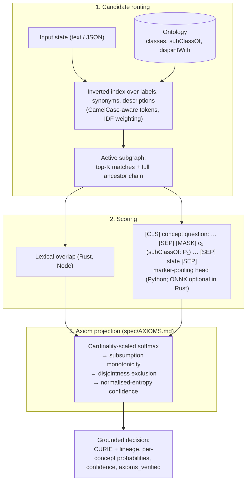

# O-Laya: Ontology-Grounded System 1 Decision Model

O-Laya grounds fast, non-autoregressive software decisions in a formal ontology: candidates come
from an OWL / RDF class hierarchy, and the output distribution is projected so that subsumption
(`P(child) ≤ P(parent)`) and disjointness (`A ⊓ B = ⊥`) hold.

It ships as three runtimes that share one ontology model and one axiom specification
([`spec/AXIOMS.md`](spec/AXIOMS.md)):

| Runtime | Package | Scoring today | Scope |
|---|---|---|---|
| **Rust** | `olaya-core` (`crates/olaya-core`) | Lexical (label / synonym / description overlap); optional ONNX cross-encoder behind the `onnx` feature | Arrow-native ontology batches, OWL/Turtle ingestion via `owl-fast-core`, constant-time routing per query |
| **Python** | `olaya` (`src/olaya`) | Transformer marker-pooling head (**untrained**, see below) | Full `system_one` API: `concept`, `subsumes`, `choice`, `score`, `noul` |
| **Node / TypeScript** | `@mycelia/olaya` (`packages/olaya-node`) | Lexical | Zero-dependency ESM + CJS; `systemOne`, `choice`, `score`, `noul` |

## Project status: read this first

- **There are no trained weights yet.** `OLaya()` in Python builds a randomly initialised
  4-layer encoder; `scripts/export_onnx_ort.py` exports that untrained model. Its concept answers
  are structurally valid (grounded in the ontology, axiom-consistent, deterministic) but the
  neural scores carry no learned signal. Treat the Python neural path as the reference
  architecture for a training pipeline, not as a classifier you can deploy. The Rust and Node
  engines use lexical overlap, which is what their benchmarks and tests measure.
- The three runtimes implement the same axiom kernel and are checked against shared golden
  vectors in CI. The `noul` primitive differs by design: Python returns `P(true)` for a yes/no
  statement, Node returns an out-of-domain rejection decision.
- `axioms_verified` on every result is computed (monotonicity and exclusion are checked on the
  final distribution), not hard-coded.

## Measured performance

Rust, lexical scoring, `olaya-core` release build, one core of the CI-class container used for
this measurement (`cargo run --release -p olaya-core --bin bench_arrow`), 10,000 decisions per
ontology size, `max_candidates = 8`:

| Concepts | Index build | Avg latency | Throughput |
|---|---|---|---|
| 100 | 0.3 ms | 4.8 µs | ~210k decisions/s |
| 10,000 | 27 ms | 4.9 µs | ~200k decisions/s |
| 100,000 | 320 ms | 4.9 µs | ~200k decisions/s |

Latency is flat in ontology size because routing only touches rows that share a token with the
state (tokens indexed under more than `MAX_QUERY_POSTINGS` rows are skipped as stopwords) plus
their ancestors. Absolute numbers depend on hardware; rerun the benchmark on yours.

The Python benchmark (`benchmarks/bench_latency.py`) measures the untrained encoder's forward pass
and is a latency smoke test only.

## How it works



For `concept` questions the Python engine scores only the most specific routed concepts and
derives each ancestor's probability as the sum of its descendants', so the hierarchy constraint
holds by construction and the answer is never an ancestor of another candidate.

## Installation

Everything installs from source; no pre-built artefacts are committed.

### Python

```bash
uv venv
uv pip install --index-url https://download.pytorch.org/whl/cpu torch   # or a CUDA/MPS build
uv pip install -e ".[dev]"
.venv/bin/python -m pytest -q
```

```python
from olaya import OLaya

olaya = OLaya()  # downloads the ModernBERT tokenizer; pass tokenizer=... to stay offline

result = olaya.system_one(
    state={"service": "billing-worker", "error": "Deadlock detected in PostgreSQL cluster."},
    questions={
        "triage": {"type": "concept", "root": "INCIDENT:ROOT",
                   "instructions": "Classify the operational incident."},
        "is_data_issue": {"type": "subsumes", "concept": "INCIDENT:DATA"},
        "urgency": {"type": "score", "criteria": ["low", "medium", "urgent", "critical"]},
        "escalate": {"type": "noul", "instructions": "Should on-call be paged?"},
    },
)

triage = result.answers["triage"]
triage.curie                    # a leaf under INCIDENT:ROOT, never the root itself
triage.lineage                  # ["INCIDENT:ROOT", "INCIDENT:DATA", "INCIDENT:DB_DEADLOCK"]-style path
triage.candidate_probabilities  # distribution over the competing leaves, sums to 1
triage.probabilities            # marginal P(C) for every concept in the active subgraph
triage.axioms_verified          # True iff monotonicity and exclusion hold on the output
```

Unknown `root` / `subsumes` concepts and malformed `choice` criteria raise `ValueError`. `choice`
accepts either a list of option names or a `{name: description}` dict.

### Rust

```toml
[dependencies]
olaya-core = { path = "crates/olaya-core" }            # add features = ["onnx"] for the neural scorer
```

```rust
use olaya_core::{OntologyBatchBuilder, OlayaEngine};

let ttl = br#"
    @prefix ex: <http://example.org/> .
    @prefix owl: <http://www.w3.org/2002/07/owl#> .
    @prefix rdfs: <http://www.w3.org/2000/01/rdf-schema#> .
    ex:DBDeadlock a owl:Class ; rdfs:label "Database Deadlock" .
"#;

let batch = OntologyBatchBuilder::from_owl_bytes(ttl, owl_fast_core::RdfFormat::Turtle)?;
let engine = OlayaEngine::new(batch)?;              // validates the schema, builds the index once
let result = engine.system_one("Fatal deadlock detected on PostgreSQL", 8)?;
println!("{} ({:.3})", result.selected_curie, result.confidence);
```

`cargo test --workspace` runs the suite; `cargo run --release -p olaya-core --bin bench_arrow`
reproduces the table above.

### Node / TypeScript

```bash
cd packages/olaya-node && bun install && bun test && bun run build
```

```typescript
import { OntologyDAG, OLaya } from "@mycelia/olaya";

const dag = new OntologyDAG([
  { id: 0, curie: "INCIDENT:DATA", label: "Data & Storage Incident", parents: [], disjointWith: [1], synonyms: ["database"] },
  { id: 1, curie: "INCIDENT:BILLING", label: "Billing Incident", parents: [], disjointWith: [0], synonyms: ["payment"] },
]);

const decision = await new OLaya(dag).systemOne("Payment webhook timeout on credit card charge");
decision.selectedConcept.label; // "Billing Incident"
decision.axiomsVerified;        // true
```

## Repository layout

```
olaya/
├── Cargo.toml                  # Rust workspace
├── pyproject.toml              # Python package + ruff/pytest config
├── spec/
│   ├── AXIOMS.md               # The shared axiom-projection kernel, normative
│   └── axioms_golden.json      # Test vectors every runtime must reproduce
├── crates/
│   ├── olaya-core/             # Arrow-native engine, router, axioms, optional ONNX scorer
│   ├── owl-fast-core/          # OWL / RDF / SKOS entity extraction on oxrdf
│   └── mycelia-ort-utils/      # ONNX Runtime session helpers
├── src/olaya/                  # Python engine, model, router, sequence builder
├── packages/olaya-node/        # @mycelia/olaya
├── scripts/
│   ├── export_onnx_ort.py      # ONNX / ORT export of the (untrained) Python model
│   └── gen_axiom_golden.py     # Regenerates spec/axioms_golden.json from the Python reference
├── benchmarks/bench_latency.py
├── models/tokenizer.json       # ModernBERT tokenizer used by tests (no network needed)
└── tests/                      # Python suite
```

## Development

CI (`.github/workflows/ci.yml`) runs on every pull request: `cargo fmt --check`, `cargo clippy
-D warnings` (with and without `onnx`), `cargo test`, `ruff check` + `ruff format --check`,
`pytest`, a check that the golden vectors are regenerated, `tsc --noEmit`, `bun test` and
`bun run build`.

To change the axiom kernel, edit the Python reference, run `python scripts/gen_axiom_golden.py`,
and bring the other runtimes to green against the regenerated file.

## Roadmap

1. Training pipeline and dataset for the Python decision head; publish weights and an ONNX export
   the Rust `onnx` feature can load.
2. Accuracy and calibration evaluation (not only latency) against labelled incident data.
3. A calibrated `subsumes` head; today it reuses the flat kernel.

## License

MIT.
