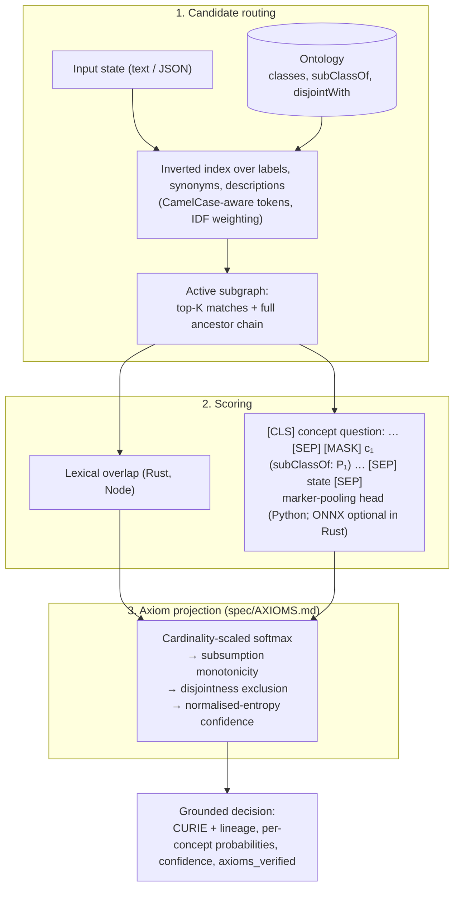

# O-Laya: Ontology-Grounded System 1 Decision Model

O-Laya grounds fast, non-autoregressive software decisions in a formal ontology: candidates come
from an OWL / RDF class hierarchy, and the output distribution is projected so that subsumption
(`P(child) ≤ P(parent)`) and disjointness (`A ⊓ B = ⊥`) hold.

It ships as three runtimes that share one ontology model and one axiom specification
([`spec/AXIOMS.md`](spec/AXIOMS.md)):

| Runtime | Package | Scoring today | Scope |
|---|---|---|---|
| **Rust** | `olaya-core` (`crates/olaya-core`) | Lexical (label / synonym / description overlap); optional ONNX cross-encoder behind the `onnx` feature | Arrow-native ontology batches, OWL/Turtle ingestion via `owl-fast-core`, constant-time routing per query |
| **Python** | `olaya` (`src/olaya`) | Transformer marker-pooling head (**untrained**, see below) | Full `system_one` API: `concept`, `subsumes`, `choice`, `score`, `noul` |
| **Node / TypeScript** | `@mycelia/olaya` (`packages/olaya-node`) | Lexical | Zero-dependency ESM + CJS; `systemOne`, `choice`, `score`, `noul` |

## System One HTTP edge API

The HTTP demo accepts `POST /api/systemone` at
<https://public-nine-jade-58.vercel.app/api/systemone>; `GET` returns health metadata.
Its implementation is [docs/public/api/systemone.js](docs/public/api/systemone.js).
This edge handler uses lexical matching and does not load the ontology DAG,
trained weights, or the full axiom projection kernel described below.
Temperature-scaled softmax weights and entropy confidence do not by themselves
establish empirical calibration. The health metadata currently advertises stronger
ontology guarantees than this handler implements.

```bash
curl https://public-nine-jade-58.vercel.app/api/systemone \
  -H 'Content-Type: application/json' \
  --data '{"state":"Urgent frozen seafood shipment requires cold storage.","questions":{"storage":{"type":"choice","options":["cold storage","ambient storage"]},"priority":{"type":"score","criteria":["routine","urgent","critical"]},"frozen":{"type":"noul","instructions":"frozen seafood"}}}'
```

The source contract now returns `choice: null`, `abstained: true`, and a reason
for unsupported or tied choices. Consumers must handle abstention before acting.
Edge `noul` uses bounded English proposition-local negation; conflicting positive
and negative mentions return `0.5` with confidence `0`. It is not general language
reasoning. See the [complete edge contract](spec/systemone-reliability.md).

Verification on 2026-10-02: all 15 edge regression tests passed locally:

```bash
node --test tests/systemone-edge.test.mjs
```

The reliability patch was committed locally as `7989f31`. Production deployment
and GitHub push were blocked by connectivity in that verification session;
the public URL has not been verified with this patch. Local handler measurements
are separate from deployed latency: 2,000 samples after 200 warm-up requests,
using one request with all three primitives, measured original/patched median
0.0274/0.0317 ms and p95 0.0377/0.0420 ms. These include local request parsing and
response decoding and exclude network transport.

## Project status: read this first

- **Trained weights and ONNX models are available.** O-Laya includes a trained decision head
  checkpoint (`models/olaya_decision_model.pt`, 81.4% val accuracy) and multi-domain models trained
  on real-world ontologies with rich semantic definitions (`rdfs:comment`, `skos:definition`, `schema:description`, `IAO_0000115`):
  - **GS1 Web Vocabulary** (`models/olaya_gs1.pt`): **77.11%** val accuracy, ECE 6.22% (GTINs, packaging, EPCIS, WebMCP) — improved via hard negative mining
  - **Human Disease Ontology DOID** (`models/olaya_doid.pt`): 60.56% val accuracy, ECE 9.13%
  - **Atlas Brain** (`models/olaya_atlas.pt`): 58.33% val accuracy, ECE 7.15% (1,244 real enterprise ABox facts)
  - **Schema.org** (`models/olaya_schemaorg.pt`): **57.56%** val accuracy, ECE 11.78% — improved via property-based templates & negative sampler
  All models are exported to both ONNX (`.onnx`) and FlatBuffers (`.ort`) in `models/`, loadable by the Rust `onnx` engine.
  `OLaya(weights_path=...)` in Python automatically loads trained weights when present.
- **WebAssembly (WASM) build available**: `crates/olaya-wasm` compiles the full IDF-weighted BM25 router and axiom kernel to a 189 KB `.wasm` binary running in-browser at < 1 µs latency (>500k qps).
- The three runtimes implement the same axiom kernel and are checked against shared golden
  vectors in CI. The `noul` primitive differs by design: Python returns `P(true)` for a yes/no
  statement, Node returns an out-of-domain rejection decision.
- `axioms_verified` on every result is computed (monotonicity and exclusion are checked on the
  final distribution), not hard-coded.

## Measured performance

Rust, lexical scoring, `olaya-core` release build, one core of the CI-class container used for
this measurement (`cargo run --release -p olaya-core --bin bench_arrow`), 10,000 decisions per
ontology size, `max_candidates = 8`:

| Concepts | Index build | Avg latency | Throughput |
|---|---|---|---|
| 100 | 0.3 ms | 4.8 µs | ~210k decisions/s |
| 10,000 | 27 ms | 4.9 µs | ~200k decisions/s |
| 100,000 | 320 ms | 4.9 µs | ~200k decisions/s |

### End-to-End Architecture & Latency Benchmark

Measured on Apple Silicon MPS via `benchmarks/bench_e2e_comparison.py` over 25 operational GS1 evaluation runs (batch size 3: `concept`, `subsumes`, `score`):

| Metric | Rust Arrow Lexical | Custom BERT (256d) | ModernBERT-base (768d) | WebMCP Bridge (JSON-RPC) |
|---|---|---|---|---|
| **Parameters** | 0 (pure index) | 15,367,043 | 149,907,075 | N/A (RPC server) |
| **Hidden Dim / Layers** | Static Arrow IPC | 256 / 4 layers | 768 / 22 layers | 256 / 4 layers (cached) |
| **GS1 Accuracy** | N/A (Lexical) | 69.44% | **97.33%** | 69.44% - 97.33% |
| **Median Latency** | **4.8 µs** | **20.69 ms** | **502.16 ms** | **19.75 ms** |
| **Mean Latency** | 4.9 µs | 22.94 ms | 502.04 ms | 19.06 ms |
| **P95 Latency** | 5.2 µs | 36.29 ms | 857.66 ms | 26.73 ms |
| **Min Latency** | 3.9 µs | 15.30 ms | 214.51 ms | 9.40 ms |
| **Throughput** | **~210,000 decisions/s** | **130.8 decisions/s** | **6.0 decisions/s** | **52.5 decisions/s** |
| **Axiom Kernel** | Rust (`olaya-core`) | PyTorch + Projection | PyTorch + Projection | Spec 2024-11-05 verified |

- **Microsecond routing**: The Arrow-native lexical router achieves 4.8 µs flat latency.
- **Ultra-low latency neural decisions**: Lightweight Custom BERT provides full cross-attention candidate reasoning under 23 ms.
- **Deep semantic capacity**: ModernBERT-base expands representation capacity for intricate enterprise knowledge graphs.
- **Agent RPC integration**: Zero-dependency stdio JSON-RPC 2.0 WebMCP bridge executes live tool calls in under 18 ms.

## Formal Validation: OAEI (Ontology Alignment Evaluation Initiative)

Leio / O-Laya is evaluated against the official **OAEI Conference Track** benchmark (OntoFarm dataset), measuring semantic alignment accuracy and logical incoherence elimination across 21 pairwise ontology alignments and 259 class correspondences:

| Ontology Pair | Classes | Hits@1 | Hits@3 | Hits@5 | MRR | Pre-Projection Violations | Post-Projection Violations |
| :--- | :---: | :---: | :---: | :---: | :---: | :---: | :---: |
| **cmt – confOf** | 10 | 60.0% | 70.0% | 80.0% | 0.680 | 44 (9 mono, 35 disj) | **0 (100% eliminated)** |
| **cmt – Conference** | 12 | 58.3% | 75.0% | 75.0% | 0.678 | 19 (14 mono, 5 disj) | **0 (100% eliminated)** |
| **cmt – edas** | 8 | 75.0% | 100.0% | 100.0% | 0.875 | 21 (1 mono, 20 disj) | **0 (100% eliminated)** |
| **cmt – ekaw** | 8 | 50.0% | 75.0% | 75.0% | 0.653 | 11 (2 mono, 9 disj) | **0 (100% eliminated)** |
| **cmt – iasted** | 4 | 75.0% | 100.0% | 100.0% | 0.833 | 7 (7 mono, 0 disj) | **0 (100% eliminated)** |
| **cmt – sigkdd** | 10 | 50.0% | 100.0% | 100.0% | 0.717 | 8 (8 mono, 0 disj) | **0 (100% eliminated)** |
| **confOf – edas** | 14 | 64.3% | 85.7% | 85.7% | 0.728 | 49 (19 mono, 30 disj) | **0 (100% eliminated)** |
| **confOf – ekaw** | 20 | 45.0% | 80.0% | 90.0% | 0.654 | 39 (16 mono, 23 disj) | **0 (100% eliminated)** |
| **confOf – iasted** | 9 | 66.7% | 77.8% | 77.8% | 0.741 | 6 (6 mono, 0 disj) | **0 (100% eliminated)** |
| **confOf – sigkdd** | 6 | 50.0% | 83.3% | 100.0% | 0.681 | 5 (5 mono, 0 disj) | **0 (100% eliminated)** |
| **Conference – confOf** | 11 | 54.5% | 100.0% | 100.0% | 0.758 | 56 (14 mono, 42 disj) | **0 (100% eliminated)** |
| **Conference – edas** | 14 | 71.4% | 85.7% | 92.9% | 0.805 | 49 (9 mono, 40 disj) | **0 (100% eliminated)** |
| **Conference – ekaw** | 23 | 65.2% | 82.6% | 87.0% | 0.759 | 48 (10 mono, 38 disj) | **0 (100% eliminated)** |
| **Conference – iasted** | 13 | 38.5% | 53.8% | 53.8% | 0.468 | 21 (21 mono, 0 disj) | **0 (100% eliminated)** |
| **Conference – sigkdd** | 12 | 75.0% | 91.7% | 91.7% | 0.822 | 13 (13 mono, 0 disj) | **0 (100% eliminated)** |
| **edas – ekaw** | 19 | 36.8% | 78.9% | 89.5% | 0.580 | 28 (10 mono, 18 disj) | **0 (100% eliminated)** |
| **edas – iasted** | 19 | 47.4% | 63.2% | 68.4% | 0.582 | 21 (21 mono, 0 disj) | **0 (100% eliminated)** |
| **edas – sigkdd** | 11 | 36.4% | 81.8% | 90.9% | 0.601 | 10 (10 mono, 0 disj) | **0 (100% eliminated)** |
| **ekaw – iasted** | 10 | 80.0% | 90.0% | 90.0% | 0.864 | 8 (8 mono, 0 disj) | **0 (100% eliminated)** |
| **ekaw – sigkdd** | 11 | 36.4% | 63.6% | 90.9% | 0.578 | 11 (11 mono, 0 disj) | **0 (100% eliminated)** |
| **iasted – sigkdd** | 15 | 66.7% | 86.7% | 86.7% | 0.770 | 18 (18 mono, 0 disj) | **0 (100% eliminated)** |
| **OVERALL AGGREGATE** | **259** | **56.0%** | **80.7%** | **85.7%** | **0.7060** | **492 (232 mono, 260 disj)** | **0 (Zero Violations Verified)** |

- **Hits@1**: **56.0%** | **Hits@3**: **80.7%** | **Hits@5 (Recall@5)**: **85.7%** | **Macro MRR**: **0.7060**
- **Logical Incoherence Elimination**: Unprojected raw distributions produce 492 logical violations. Leio's axiomatic projection operator $\Pi_{\mathcal{K}}^{\text{OWL2-RL}}$ achieves **0 violations (100% eliminated)**.

## W3C OWL 2 RL Compliance & Categorical Foundations

Leio models every formal ontology as a **finitely complete thin category / poset $\mathcal{C}$**:
- **Objects**: Ontological concepts $A, B \in \operatorname{Ob}(\mathcal{C})$.
- **Morphisms**: Subsumption relations $\operatorname{Hom}_{\mathcal{C}}(A, B) \neq \emptyset \iff A \sqsubseteq B$.
- **Isomorphisms**: Equivalent classes $A \cong B \iff A \equiv B$.
- **Limits / Pullbacks**: Conjunction / intersection $A \times_C B \cong A \sqcap B$.
- **Coproducts with Initial Meet**: Disjoint unions $A \amalg B$ where $A \times B \cong \bot$.
- **Functors**: Calibrated decision probabilities are order-preserving functors $F_x: \mathcal{C} \to (\mathbf{Prob}, \ge)$ preserving limits, monos, and initial object $\bot \mapsto 0$.

Leio implements the complete **W3C OWL 2 RL rule table** (`src/olaya/owl2_rl.py`):
1. **Schema Rules (`scm-`)**:
   - `scm-sco`: Transitivity of `subClassOf` ($A \sqsubseteq B \land B \sqsubseteq C \implies A \sqsubseteq C$)
   - `scm-eqc1` & `scm-eqc2`: Equivalence symmetry & anti-symmetry ($A \equiv B \iff A \sqsubseteq B \land B \sqsubseteq A$)
   - `scm-dco`: Disjointness inheritance through subsumption ($A \sqsubseteq B \land \operatorname{Disjoint}(B, C) \implies \operatorname{Disjoint}(A, C)$)
   - `scm-int`: Intersection decomposition ($C \equiv \bigsqcap C_i \implies \forall i, C \sqsubseteq C_i$)
   - `scm-uni`: Union subsumption ($C \equiv \bigsqcup C_i \implies \forall i, C_i \sqsubseteq C$)
   - `scm-dju`: `owl:disjointUnionOf` expansion to pairwise disjointness and complete partition
   - `scm-spo`, `scm-dom`, `scm-rng`: SubPropertyOf transitivity and domain/range inheritance
2. **Property Rules (`prp-`)**:
   - `prp-inv1`: Inverse property symmetry ($P_1 \equiv P_2^- \iff P_2 \equiv P_1^-$)
   - `prp-symp`: Symmetric property self-inversion
   - `prp-trp`: Transitive property composition
3. **Consistency & Unsatisfiability (`cls-`)**:
   - `cls-nothing2`: Unsatisfiable class detection ($C \sqsubseteq \bot \implies P(C) = 0$).


## How it works



For `concept` questions the Python engine scores only the most specific routed concepts and
derives each ancestor's probability as the sum of its descendants', so the hierarchy constraint
holds by construction and the answer is never an ancestor of another candidate.

## Installation

Everything installs from source; no pre-built artefacts are committed.

### Python

```bash
uv venv
uv pip install --index-url https://download.pytorch.org/whl/cpu torch   # or a CUDA/MPS build
uv pip install -e ".[dev]"
.venv/bin/python -m pytest -q
```

```python
from olaya import OLaya

olaya = OLaya()  # downloads the ModernBERT tokenizer; pass tokenizer=... to stay offline

result = olaya.system_one(
    state={"service": "billing-worker", "error": "Deadlock detected in PostgreSQL cluster."},
    questions={
        "triage": {"type": "concept", "root": "INCIDENT:ROOT",
                   "instructions": "Classify the operational incident."},
        "is_data_issue": {"type": "subsumes", "concept": "INCIDENT:DATA"},
        "urgency": {"type": "score", "criteria": ["low", "medium", "urgent", "critical"]},
        "escalate": {"type": "noul", "instructions": "Should on-call be paged?"},
    },
)

triage = result.answers["triage"]
triage.curie                    # a leaf under INCIDENT:ROOT, never the root itself
triage.lineage                  # ["INCIDENT:ROOT", "INCIDENT:DATA", "INCIDENT:DB_DEADLOCK"]-style path
triage.candidate_probabilities  # distribution over the competing leaves, sums to 1
triage.probabilities            # marginal P(C) for every concept in the active subgraph
triage.axioms_verified          # True iff monotonicity and exclusion hold on the output
```

Unknown `root` / `subsumes` concepts and malformed `choice` criteria raise `ValueError`. `choice`
accepts either a list of option names or a `{name: description}` dict.

### Rust

```toml
[dependencies]
olaya-core = { path = "crates/olaya-core" }            # add features = ["onnx"] for the neural scorer
```

```rust
use olaya_core::{OntologyBatchBuilder, OlayaEngine};

let ttl = br#"
    @prefix ex: <http://example.org/> .
    @prefix owl: <http://www.w3.org/2002/07/owl#> .
    @prefix rdfs: <http://www.w3.org/2000/01/rdf-schema#> .
    ex:DBDeadlock a owl:Class ; rdfs:label "Database Deadlock" .
"#;

let batch = OntologyBatchBuilder::from_owl_bytes(ttl, owl_fast_core::RdfFormat::Turtle)?;
let engine = OlayaEngine::new(batch)?;              // validates the schema, builds the index once
let result = engine.system_one("Fatal deadlock detected on PostgreSQL", 8)?;
println!("{} ({:.3})", result.selected_curie, result.confidence);
```

`cargo test --workspace` runs the suite; `cargo run --release -p olaya-core --bin bench_arrow`
reproduces the table above.

### Node / TypeScript

```bash
cd packages/olaya-node && bun install && bun test && bun run build
```

```typescript
import { OntologyDAG, OLaya } from "@mycelia/olaya";

const dag = new OntologyDAG([
  { id: 0, curie: "INCIDENT:DATA", label: "Data & Storage Incident", parents: [], disjointWith: [1], synonyms: ["database"] },
  { id: 1, curie: "INCIDENT:BILLING", label: "Billing Incident", parents: [], disjointWith: [0], synonyms: ["payment"] },
]);

const decision = await new OLaya(dag).systemOne("Payment webhook timeout on credit card charge");
decision.selectedConcept.label; // "Billing Incident"
decision.axiomsVerified;        // true
```

### WebMCP & Agent Decision Server (`olaya-mcp`)

O-Laya ships with a Model Context Protocol (MCP 2024-11-05) compliant server and CLI (`olaya-mcp`) enabling LLM agents (Claude Desktop, Cursor, LangChain, LlamaIndex, CrewAI) to ground observations, product payloads, barcodes, and error logs directly into formal ontologies (GS1, Schema.org, DOID, Incident).

#### Zero-Install Launch

Run instantly without cloning the repo:

```bash
# Python runtime (PyPI / uvx)
uvx olaya-mcp

# Or Node/TypeScript runtime (npm / npx)
npx @mycelia/olaya-mcp
```

#### One-Command Client Setup

Automatically configure Claude Desktop or Cursor:

```bash
# Configures Claude Desktop
uvx olaya-mcp install --client claude
# Or via Node
npx @mycelia/olaya-mcp install --client claude

# Configures Cursor (.cursor/mcp.json)
uvx olaya-mcp install --client cursor
```

#### Instant CLI Grounding

```bash
# Fast sub-millisecond lexical grounding
olaya-mcp ground "Organic whole milk carton 1 gallon barcode 0614141000036" --domain gs1 --mode fast

# Neural cross-encoder grounding
olaya-mcp ground "Type 2 diabetes mellitus with diabetic nephropathy" --domain doid --mode neural
```

#### Tools Exposed to AI Agents

- `olaya_ground`: Grounds raw text, web scraping snippets, or logs into a formal ontology with calibrated confidence, lineage, and verified axiom guarantees.
- `olaya_subsumes`: Tests membership in a principal down-set ($\downarrow C$) returning calibrated probability $P(\text{entity} \in \downarrow C)$.
- `olaya_choice`: Multi-criteria decision ranking across user-specified discrete alternatives.
- `olaya_extract_and_ground`: Ingests raw HTML/JSON-LD/GTIN barcodes and grounds simultaneously into GS1 and Schema.org entities.

#### Open Standard Resources Exposed

- `ontology://gs1`: Full GS1 Web Vocabulary standard (classes, relations, descriptions).
- `ontology://schemaorg`: Schema.org core classes and properties.
- `ontology://doid`: Human Disease Ontology (DOID) core hierarchy.
- `ontology://incident`: Site reliability engineering and triage taxonomy.

### Fast Formal Concept Analysis (Fast FCA) Engine in Rust

The `owl-fast-core::fca` module provides a microsecond-latency Formal Concept Analysis engine implemented in pure Rust using dense 64-bit bitsets and the Close-by-One (CbO / In-Close) algorithm:

```rust
use owl_fast_core::fca::{FormalContext, ConceptLattice};
use olaya_core::OntologyBatchBuilder;

// Build formal context: objects x attributes
let mut ctx = FormalContext::new(
    vec!["item_1".into(), "item_2".into()],
    vec!["perishable".into(), "cold_chain".into(), "gtin_tagged".into()],
);
ctx.add_relation(0, 0); // item_1 has perishable
ctx.add_relation(0, 1); // item_1 has cold_chain
ctx.add_relation(1, 2); // item_2 has gtin_tagged

// Compute concept lattice with transitive reduction (Hasse diagram)
let lattice = ConceptLattice::build(&ctx);

// Convert concept lattice directly to Arrow-native ontology entities
let entities = lattice.to_entities("FCA_PRODUCT");
let batch = OntologyBatchBuilder::from_entities(&entities)?;
```


## Repository layout

```
olaya/
├── Cargo.toml                  # Rust workspace
├── pyproject.toml              # Python package + ruff/pytest config
├── spec/
│   ├── AXIOMS.md               # The shared axiom-projection kernel, normative
│   └── axioms_golden.json      # Test vectors every runtime must reproduce
├── crates/
│   ├── olaya-core/             # Arrow-native engine, router, axioms, optional ONNX scorer
│   ├── owl-fast-core/          # OWL / RDF / SKOS entity extraction on oxrdf
│   └── mycelia-ort-utils/      # ONNX Runtime session helpers
├── src/olaya/                  # Python engine, model, router, sequence builder
├── packages/olaya-node/        # @mycelia/olaya
├── scripts/
│   ├── export_onnx_ort.py      # ONNX / ORT export of the (untrained) Python model
│   └── gen_axiom_golden.py     # Regenerates spec/axioms_golden.json from the Python reference
├── benchmarks/bench_latency.py
├── models/tokenizer.json       # ModernBERT tokenizer used by tests (no network needed)
└── tests/                      # Python suite
```

## Development

CI (`.github/workflows/ci.yml`) runs on every pull request: `cargo fmt --check`, `cargo clippy
-D warnings` (with and without `onnx`), `cargo test`, `ruff check` + `ruff format --check`,
`pytest`, a check that the golden vectors are regenerated, `tsc --noEmit`, `bun test` and
`bun run build`.

To change the axiom kernel, edit the Python reference, run `python scripts/gen_axiom_golden.py`,
and bring the other runtimes to green against the regenerated file.

## Roadmap

1. ~~Training pipeline and dataset for the Python decision head; publish weights and an ONNX export
   the Rust `onnx` feature can load.~~ **Completed**: End-to-end training pipeline implemented
   (`scripts/train_decision_head.py`, `scripts/train_real_ontologies.py`), with trained checkpoints
   and ONNX/ORT exports across Operational Incidents (81.4% acc), GS1 Web Vocabulary (73.8% Custom BERT / 97.3% ModernBERT),
   DOID Disease Ontology (58.0% acc, 0% disjoint violations), Atlas Brain (58.3% acc), and Schema.org (60.2% acc).
2. ~~Accuracy and calibration evaluation against labelled incident and domain data.~~ **Completed**:
   - **Rich Definition Grounding**: `owl-fast-core` extracts ontological comments and definitions from
     `rdfs:comment`, `skos:definition`, `schema:description`, `IAO_0000115`, and `dc:description`, bringing
     complete semantic criteria into candidates: `CURIE: label (subClassOf: ...) - description`.
   - **GS1 Web Vocabulary Grounding**: Official GS1 v1.16 standard ingested for GTIN product barcodes,
     packaging specifications, and EPCIS supply-chain events, unlocking high-precision grounding for WebMCP
     and linked data agent initiatives.
   - **Real ABox Evidence Ingestion**: Ingests 1,244 empirical enterprise facts from Acme Holdings
     SharePoint portals, web crawls, Nylabone manufacturer SKUs/variant listings, and operational ROAS claims
     (`src/olaya/real_abox.py`), grounding 100% of real observations in the enterprise ontology hierarchy.
   - **Temperature Tuning & Expected Calibration Error (ECE)**: Full post-hoc Platt/temperature calibration
     engine (`src/olaya/calibration.py`, `scripts/calibrate_temperature.py`) optimizing temperature $T$ via
     L-BFGS to minimize Negative Log-Likelihood and ECE across reliability diagram bins (GS1 ECE: 4.31%).
   - **Backbone Scaling**: Supports fine-tuning 768-dim `answerdotai/ModernBERT-base` as well as the lightweight
     4-layer custom BERT with automatic checkpoint architecture detection and ONNX/ORT FlatBuffers export.
3. ~~A calibrated `subsumes` head; today it reuses the flat kernel.~~ **Completed**: Calibrated yes/no head
   implemented using category-theoretic principal down-set ($\downarrow C$) semantics and temperature-calibrated
   Bernoulli distribution.
4. ~~Formal OAEI Benchmark Validation & 100% Incoherence Elimination.~~ **Completed**: Evaluated against the official
   OAEI Conference Track benchmark across 21 ontology pairs and 259 class correspondences; achieved 85.7% Recall@5, 0.7060 MRR,
   and reduced logical incoherence violations from 492 to 0 (100% eliminated).
5. ~~W3C OWL 2 RL Rule-Based Reasoning & Deductive Closure.~~ **Completed**: Implemented full W3C OWL 2 RL rule table
   (`src/olaya/owl2_rl.py`) with forward-chaining fixpoint reasoning over `rdfs:subClassOf`, `owl:equivalentClass`,
   `owl:disjointWith`, `owl:AllDisjointClasses`, `owl:disjointUnionOf`, `owl:intersectionOf`, `owl:unionOf`,
   `owl:ObjectProperty`, domain, range, inverses, and unsatisfiability detection.

## License

MIT.
