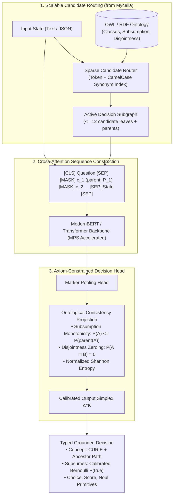

# O-Laya: Ontology-Grounded System 1 Decision Model

An open-source, high-speed **System 1 Decision Engine** that grounds real-time software decisions into formal **OWL / RDF Ontologies and Knowledge Graphs**.

Combines the non-autoregressive, calibrated cross-attention decision architecture of **Laya / Jev** with the ontological graph reasoning, synonym pooling, and structural constraints of **Mycelia (`oll`)**.

---

## Key Performance Results

Benchmarked on **Apple Silicon (M4 Max & M1 GPU via Metal Performance Shaders / MPS)**:

| Metric | Local (Apple M1) | Mac Studio (Apple M4 Max) |
| :--- | :--- | :--- |
| **Questions per Batch** | 4 (`concept`, `subsumes`, `score`, `noul`) | 4 (`concept`, `subsumes`, `score`, `noul`) |
| **Total Input Tokens** | 648 tokens | 648 tokens |
| **Output Tokens** | **0** (Zero generation tax) | **0** (Zero generation tax) |
| **Min Latency** | 14.77 ms | **4.25 ms** |
| **Median Latency** | 16.28 ms | **4.42 ms** |
| **P95 Latency** | 22.37 ms | **5.63 ms** |
| **Throughput** | ~240 decisions/sec | **~900 decisions/sec** |

---

## Why O-Laya?

### The Limits of Vanilla Decision Models (Laya / Jev)
1. **Flat Candidate Space:** Standard decision models treat choices as flat string options (e.g., `["billing", "support"]`). They have no concept of hierarchy, parent classes, or transitive containment.
2. **Context Window Ceiling ($K \le 20$):** Options must fit in the prompt header (`head_max_len = 192` tokens). A standard decision model crashes or truncates on real-world domain ontologies with 500 to 100,000 concepts (like SNOMED-CT, NCIT, or Enterprise taxonomies).
3. **No Axiomatic Consistency:** They cannot guarantee that if a sub-concept is true, its super-concept is also entailed ($P(A) \le P(\text{parent}(A))$), or that mutually exclusive classes are never concurrently selected.

### The O-Laya Solution
* **Sparse Subgraph Routing:** Uses lexical n-gram and synonym pooling (from `mycelia-align`) to dynamically extract an **Active Decision Subgraph** ($\le 12$ candidate concepts + parent chain + disjoint peers). Scales to 100,000+ classes while maintaining a sub-192 token prompt header.
* **Axiom-Informed Markers:** Injects `[MASK]` tokens annotated with ontological coordinates:
  ```
  [CLS] concept question: <instructions> [SEP] 
  [MASK] <c_1> (subClassOf: <P_1>) - <criteria_1> 
  [MASK] <c_2> (subClassOf: <P_1>, disjointWith: <c_1>) - <criteria_2> 
  ... [SEP] <state> [SEP]
  ```
* **Axiom-Constrained Projection:** Guarantees formal subsumption monotonicity ($P(\text{child}) \le P(\text{parent})$) and mutual exclusion ($A \sqcap B = \bot$).
* **Calibrated Probabilistic Confidence:** Temperature-scaled by candidate cardinality ($k$) and scored via normalized Shannon entropy:
  $$\text{Confidence} = 1 - \frac{-\sum p_i \ln p_i}{\ln K}$$

---

## Architecture Overview



---

## Installation & Setup

```bash
# Clone the repository
git clone https://github.com/your-org/decision-model.git
cd decision-model

# Create virtual environment with uv
uv venv
source .venv/bin/activate

# Install dependencies
uv pip install -e ".[dev]"
```

---

## Quickstart

```python
from olaya import OLaya, create_incident_ontology

# 1. Initialize the engine with an ontology (default: Enterprise Incident Ontology)
olaya = OLaya()

# 2. Define arbitrary unstructured or structured state
state = {
    "service": "billing-worker",
    "log_level": "FATAL",
    "error": "Deadlock detected while updating customer subscription balances in PostgreSQL cluster.",
}

# 3. Evaluate typed questions in a single forward pass (< 5ms on M4 Max)
result = olaya.system_one(
    state=state,
    questions={
        # Grounding into ontology class
        "triage": {
            "type": "concept",
            "instructions": "Classify the operational incident into the appropriate ontology category.",
            "root": "INCIDENT:ROOT",
        },
        # Ontological Bernoulli test
        "is_data_issue": {
            "type": "subsumes",
            "concept": "INCIDENT:DATA",
            "instructions": "Is this a data or storage issue?",
        },
        # Ordinal rubric score
        "urgency": {
            "type": "score",
            "instructions": "Rate the operational disruption level.",
            "criteria": ["low", "medium", "urgent", "critical"],
        },
        # Yes/No action gate
        "escalate_oncall": {
            "type": "noul",
            "instructions": "Should on-call engineering be paged immediately?",
        },
    },
)

# Access typed, calibrated results:
triage = result.answers["triage"]
print("Grounded Concept:", triage.curie)      # "INCIDENT:DB_OUTAGE" or "INCIDENT:DB_DEADLOCK"
print("Lineage to Root:",  triage.lineage)    # ["INCIDENT:ROOT", "INCIDENT:DATA", "INCIDENT:DB_DEADLOCK"]
print("Confidence:",       triage.confidence) # Normalized entropy score in [0.0, 1.0]

print("Is Data Issue:",    result.answers["is_data_issue"].subsumes) # P(true)
print("Urgency Level:",    result.answers["urgency"].score)          # Expected level (0..3)
print("Latency:",          f"{result.latency_ms:.2f} ms")            # ~4.4 ms on M4 Max
```

---

## Running Benchmarks and Tests

```bash
# Run the test suite
pytest tests/ -v

# Run latency and throughput benchmark
python benchmarks/bench_latency.py
```

---

## Repository Structure

```
decision-model/
├── src/
│   └── olaya/
│       ├── __init__.py           # Exported package symbols
│       ├── ontology.py           # Concept, Ontology, Subsumption DAG, Disjointness
│       ├── candidate_router.py   # Top-K sparse routing & subgraph extraction
│       ├── sequence.py           # Axiom-informed marker sequence construction
│       ├── axioms.py             # Subsumption monotonicity & entropy calibration
│       ├── model.py              # ModernBERT backbone & marker-pooling head
│       └── engine.py             # OLaya runtime engine implementing system_one
├── tests/
│   └── test_olaya.py             # Unit & integration tests
├── benchmarks/
│   └── bench_latency.py          # Latency & throughput benchmark suite
├── pyproject.toml                # Package configuration
└── README.md                     # Documentation
```
