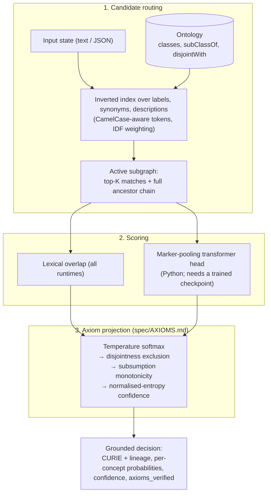

# O-Laya: Ontology-Grounded System 1 Decisions

O-Laya turns a fast, non-autoregressive scorer into a decision engine whose output
respects a formal ontology. Candidates come from an OWL / RDF class hierarchy and
every output distribution is projected so that subsumption (`P(child) ≤ P(parent)`)
and disjointness (`A ⊓ B = ⊥`) hold. Each answer carries a CURIE, its lineage, the
per-concept probabilities, an entropy-based confidence, and a computed
`axioms_verified` flag.

It ships as three runtimes that share one ontology model, one axiom
specification ([`spec/AXIOMS.md`](spec/AXIOMS.md)) and one set of golden vectors
checked in CI, plus a TBox-bound workflow layer that records and replays
decisions as JSON-LD provenance.

## What is and is not here

Read this before anything else.

| Component | State |
|---|---|
| Ontology DAG, OWL 2 RL schema closure, axiom projection kernel | Implemented, deterministic, tested in Python, Rust and Node against shared golden vectors |
| OWL / RDF / SKOS / OBO ingestion to Arrow IPC (`owl-fast-core`, `olaya-core`) | Implemented; 13 real ontologies tracked as fixtures and exercised in tests |
| Formal Concept Analysis engine (`owl-fast-core::fca`) | Implemented and tested |
| Lean 4 proof core (`lean/`) | Steps 3–4 of the axiom kernel and the verifier are formalised over integer scores; `project_verified` and 15 supporting theorems, no `sorry`, axioms audited in CI. Softmax, confidence, and the `K`-sweep convergence bound are **not** proven. See [`spec/AXIOMS.md`](spec/AXIOMS.md). |
| TBox-bound workflow compiler, interpreter, JSON-LD traces, inference-free replay | Implemented and tested |
| Lexical scoring (label / synonym / description overlap with IDF) | Implemented in every runtime. **This is what every shipped runtime uses to score.** |
| Neural scoring head (Python, PyTorch) | Implemented and trainable. **No trained weights are committed.** `OLaya()` without a checkpoint is a randomly initialised encoder; its scores are not meaningful. |
| ONNX path in Rust (`onnx` feature) | Compiles. No model to load, no end-to-end test. |
| WebAssembly build | Builds in CI for `wasm32-unknown-unknown`; kernel unit-tested. |
| Calibration | Temperature fitting (`calibration.py`) is implemented and used at inference when a checkpoint carries a fitted temperature. Without one, confidence is normalised entropy with a fixed cardinality temperature and is **not** an empirically calibrated probability. |
| Published packages | **Not yet on PyPI or npm.** `release.yml` publishes `olaya` (PyPI) and `@josaum/leio` (npm) from the tagged commit; until the first publish, install from a locally built wheel (see Installation). |
| HTTP edge demo (`/api/systemone`) | Live, lexical only, no ontology DAG. See [the edge contract](spec/systemone-reliability.md). |

No accuracy, ECE, or latency number in this repository applies to a trained
neural model, because none is committed. The only external benchmark we report
is the OAEI Conference track below, run with the lexical matcher on vendored
upstream data, reproducible with one command.

## OAEI Conference track (the one external benchmark)

O-Laya's matchers are evaluated with the standard OAEI alignment protocol on
the Conference track (OntoFarm, reference alignment ra1, 21 ontology pairs, 259
class and 46 property correspondences): every cross pair is scored, mutual-best
1:1 correspondences above a threshold fixed a priori (0.50) form the alignment,
and precision / recall / F1 are computed against ra1 for classes (M1),
properties (M2) and both (M3), micro-averaged over the 21 pairs as OAEI does.
Three matchers are reported: a dependency-free lexical matcher, a hybrid that
runs the lexical matcher first and lets a small local sentence encoder
(`intfloat/e5-small-v2`, CSLS-calibrated cosine over the label, the description
or the entity's path from the root) decide only the leftover
entities, and the hybrid plus training-free structural propagation over the
ontology graphs (Similarity Flooding, neighbour aggregation or embedding
smoothing, `olaya.benchmarks.structural`). Reproduce with
`.venv/bin/python scripts/benchmark_oaei.py` (about 10 min with the encoder, or
`--no-embeddings` for the lexical and lexical + structure rows in about 20 s;
vendored upstream data in `tests/fixtures/oaei/`).

| System (OAEI 2023, ra1, micro) | M1 P / R / F1 | M3 P / R / F1 |
| :--- | :---: | :---: |
| GraphMatcher | 0.78 / 0.89 / **0.83** | 0.76 / 0.80 / **0.78** |
| SORBETMtch | 0.78 / 0.75 / 0.76 | 0.78 / 0.64 / 0.70 |
| LogMap | 0.84 / 0.63 / 0.72 | 0.81 / 0.58 / 0.68 |
| Matcha | 0.76 / 0.68 / 0.72 | 0.70 / 0.64 / 0.67 |
| **olaya-hybrid (this repo, leave-one-pair-out CV)** | 0.81 / 0.69 / 0.75 | 0.69 / 0.66 / 0.68 |
| **olaya-hybrid + structure (this repo, leave-one-pair-out CV, union grid)** | 0.81 / 0.69 / 0.75 | 0.69 / 0.66 / 0.68 |
| **olaya-lexical (this repo, threshold 0.50)** | 0.83 / 0.64 / 0.73 | 0.73 / 0.60 / 0.66 |
| edna (baseline) | 0.88 / 0.54 / 0.67 | 0.79 / 0.47 / 0.59 |
| StringEquiv (baseline) | 0.88 / 0.50 / 0.64 | 0.80 / 0.43 / 0.56 |

Where we land: the hybrid's headline is cross-validated (threshold and fusion
weight chosen on the other 20 pairs for each held-out pair), which makes it the
honest number; the best configuration picked on the full set scores 0.76 / 0.69.
It ranks third on both tables: below GraphMatcher by 0.08 (M1) and 0.10 (M3),
below SORBETMtch by 0.01 and 0.02, tied with LogMap on M3 and above LogMap and
Matcha on M1. The lexical matcher alone is 0.02 behind the hybrid on both. It is
not state of the art. Structural propagation did not help: seeded by the hybrid, the
best structural grid point scores 0.75 / 0.69 on ra1 (optimistic), but when the
hybrid and structural grids are cross-validated together the selection never picks
a structural config once the hybrid grid contains the path text, so the headline
stays the hybrid. Structure does raise recall
(Similarity Flooding reaches M1 recall 0.84, close to GraphMatcher's 0.89) but
precision falls faster, because a training-free propagation cannot tell a matching
sibling pair from a merely parallel one; GraphMatcher's recall comes from attention
trained on these ontologies. The design choices (cascade fusion, CSLS, encoder,
propagation rules) were made after seeing ra1; only the numeric knobs are protected
by the CV. An error analysis of every missed and spurious correspondence
([`benchmarks/results/oaei-error-analysis.md`](benchmarks/results/oaei-error-analysis.md))
shows that recall is lost mostly at the threshold on compound labels and at the
scoring of synonyms; of everything it motivated (richer texts, head nouns, fused
scores, larger encoders and ensembles, Hungarian and margin decoders, adaptive
thresholds) only encoding the entity's path from the root helps under
cross-validation, and only on its own threshold sub-grid (+0.04 M3); on the
full grid the headline is unchanged within noise. Applying the OWL 2
RL coherence repair to the alignment *lowers* F1 on ra1 by about 0.02 (ra1 is the
unrepaired reference; the repaired rar2 is not vendored), so it is opt-in and not
part of the headline number. Full per-pair numbers, the threshold sweep, dataset
hashes and the published sources are in
[`benchmarks/results/oaei-conference-ra1.md`](benchmarks/results/oaei-conference-ra1.md)
and [`oaei-conference-ra1.json`](benchmarks/results/oaei-conference-ra1.json).
An LLM-judge stage (candidates from the hybrid, a language model asked with
ontology context whether each pair is equivalent; `scripts/benchmark_oaei_llm.py`,
category LLM-based) is built and validated offline with a reference-backed stub in
[`benchmarks/results/oaei-llm.md`](benchmarks/results/oaei-llm.md); its real-judge
numbers are pending an API key and are not part of the table above.
Earlier versions of this README reported hits@k with the gold target guaranteed to be
in the candidate set and a "100% violation elimination" figure computed on synthetic
distributions; both were retracted because they were not benchmark results.

## How it works



For `concept` questions the Python engine scores only the most specific routed
concepts and derives each ancestor's probability as the sum of its descendants',
so the hierarchy constraint holds by construction and the answer is never an
ancestor of another candidate.

## Runtimes

| Runtime | Package | Scoring | Scope |
|---|---|---|---|
| **Rust** | `olaya-core` (`crates/olaya-core`) | Lexical; optional ONNX cross-encoder behind the `onnx` feature (no bundled model) | Arrow-native ontology batches, OWL/Turtle ingestion via `owl-fast-core`, constant-time routing per query |
| **Python** | `olaya` (`src/olaya`) | Transformer marker-pooling head (untrained unless you supply a checkpoint) | Full `system_one` API: `concept`, `subsumes`, `choice`, `score`, `noul`; training, calibration, workflows, MCP server |
| **Node / TypeScript** | `leio` (`packages/olaya-node`) | Lexical | Zero-dependency ESM + CJS; `systemOne`, `choice`, `score`, `noul`; MCP server |

The `noul` primitive differs by design: Python returns `P(true)` for a yes/no
statement, Node returns an out-of-domain rejection decision, and the edge demo
returns a bounded negation-aware lexical score with explicit abstention.

## Installation

Until the first registry publish lands, install from a wheel built in this checkout. The
Central M&A toolkit consumes O-Laya the same way (a hash-pinned vendored wheel).

```bash
uv build --wheel --out-dir dist                      # dist/olaya-0.3.1-py3-none-any.whl
uvx --from dist/olaya-0.3.1-py3-none-any.whl leio     # MCP server straight from the wheel
uv pip install dist/olaya-0.3.1-py3-none-any.whl      # into a venv: provides `leio`, `leio-mcp`, `olaya-mcp`
```

The wheel's base dependencies include torch (about 2 GB); `olaya.pii` alone is standard library.

Registry installs, live once the release workflow has published `olaya` to PyPI and
`@josaum/leio` to npm (wired in `release.yml`; first publish pending):

```bash
uvx olaya                # Python MCP server, no install step
npx @josaum/leio        # Node MCP server, zero dependencies
pip install olaya        # Python SDK
```

From source (no pre-built artefacts are committed):

### Python

```bash
uv venv
uv pip install --index-url https://download.pytorch.org/whl/cpu torch   # or a CUDA/MPS build
uv pip install -e ".[dev]"
.venv/bin/python -m pytest -q
```

```python
from olaya import OLaya

olaya = OLaya()  # random-init encoder unless weights_path= points at a checkpoint

result = olaya.system_one(
    state={"service": "billing-worker", "error": "Deadlock detected in PostgreSQL cluster."},
    questions={
        "triage": {"type": "concept", "root": "INCIDENT:ROOT",
                   "instructions": "Classify the operational incident."},
        "is_data_issue": {"type": "subsumes", "concept": "INCIDENT:DATA"},
        "urgency": {"type": "score", "criteria": ["low", "medium", "urgent", "critical"]},
        "escalate": {"type": "noul", "instructions": "Should on-call be paged?"},
    },
)

triage = result.answers["triage"]
triage.curie                    # a leaf under INCIDENT:ROOT, never the root itself
triage.lineage                  # ["INCIDENT:ROOT", "INCIDENT:DATA", "INCIDENT:DB_DEADLOCK"]-style path
triage.candidate_probabilities  # distribution over the competing leaves, sums to 1
triage.probabilities            # marginal P(C) for every concept in the active subgraph
triage.axioms_verified          # True iff monotonicity and exclusion hold on the output
result.model                    # provenance: checkpoint hash, or "untrained-random-init"
```

Unknown `root` / `subsumes` concepts and malformed `choice` criteria raise `ValueError`. `choice`
accepts either a list of option names or a `{name: description}` dict.

To train a head on your own ontology and get a checkpoint the engine will load:

```bash
.venv/bin/python scripts/train_real_ontologies.py --domain schemaorg \
  --ontology-path docs/public/ontologies/schemaorg_ontology.json --epochs 5 --device cpu
```

Training splits source observations into disjoint train / validation /
calibration / test groups before task expansion, selects the checkpoint on
validation, fits temperature on calibration, and reports accuracy, NLL, ECE and
Brier on test. See [evaluation integrity](spec/evaluation-integrity.md) for
what those numbers can and cannot establish.

### Rust

```toml
[dependencies]
olaya-core = { path = "crates/olaya-core" }            # add features = ["onnx"] for the neural scorer
```

```rust
use olaya_core::{OntologyBatchBuilder, OlayaEngine};

let ttl = br#"
    @prefix ex: <http://example.org/> .
    @prefix owl: <http://www.w3.org/2002/07/owl#> .
    @prefix rdfs: <http://www.w3.org/2000/01/rdf-schema#> .
    ex:DBDeadlock a owl:Class ; rdfs:label "Database Deadlock" .
"#;

let batch = OntologyBatchBuilder::from_owl_bytes(ttl, owl_fast_core::RdfFormat::Turtle)?;
let engine = OlayaEngine::new(batch)?;              // validates the schema, builds the index once
let result = engine.system_one("Fatal deadlock detected on PostgreSQL", 8)?;
println!("{} ({:.3})", result.selected_curie, result.confidence);
```

`cargo test --workspace` runs the suite. `cargo run --release -p olaya-core --bin bench_arrow`
measures lexical routing latency on your machine; we do not publish numbers from
other machines here.

`owl-fast-core::fca` builds a concept lattice from an object/attribute context
(Close-by-One over dense bitsets) and converts it into ontology entities the
engine can load:

```rust
use owl_fast_core::fca::{ConceptLattice, FormalContext};

let ctx = FormalContext::from_named_pairs(&[
    ("item_1", "perishable"),
    ("item_1", "cold_chain"),
    ("item_2", "gtin_tagged"),
]);
let lattice = ConceptLattice::build(ctx);
let entities = lattice.to_ontology_entities("FCA_PRODUCT");
let batch = olaya_core::OntologyBatchBuilder::from_entities(&entities)?;
```

### Node / TypeScript

```bash
cd packages/olaya-node && bun install && bun test && bun run build
```

```typescript
import { OntologyDAG, OLaya } from "@josaum/leio";

const dag = new OntologyDAG([
  { id: 0, curie: "INCIDENT:DATA", label: "Data & Storage Incident", parents: [], disjointWith: [1], synonyms: ["database"] },
  { id: 1, curie: "INCIDENT:BILLING", label: "Billing Incident", parents: [], disjointWith: [0], synonyms: ["payment"] },
]);

const decision = await new OLaya(dag).systemOne("Payment webhook timeout on credit card charge");
decision.selectedConcept.label; // "Billing Incident"
decision.axiomsVerified;        // true
```

### MCP servers

Both the Python and Node packages expose a Model Context Protocol server over
stdio. Neither is published to a registry yet; run them from a checkout:

```bash
.venv/bin/olaya-mcp                       # Python runtime
cd packages/olaya-node && bun run src/cli.ts   # Node runtime
```

Tools: `olaya_ground` (concept grounding with lineage and `axioms_verified`),
`olaya_subsumes`, `olaya_choice`, `olaya_score`; the Python server also offers
`olaya_extract_and_ground` (JSON-LD / GTIN extraction then grounding). Bundled ontologies are the JSON files under
`src/olaya/data/` and `docs/public/ontologies/`; the resource descriptions state
the actual class counts. Confidence is entropy-based, not calibrated, unless the
Python server loads a checkpoint with a fitted temperature.

## TBox-bound workflows

The Python JSON workflow compiler and interpreter bind workflow and decision
types, option classes, terminal intent properties, and declared
infrastructure / application resources to a supplied ontology. It emits JSON-LD
execution records with TBox identity and hash plus decision provenance, and
`olaya.workflow_replay.replay_workflow` re-checks a recorded trace against the
compiled policy without model inference. See the
[version 1 contract](spec/workflow-dsl-proposal.md) and the
[storage example](examples/workflows/storage.json):

```bash
python examples/workflows/run_storage.py
```

Terminal intents are records, not actions: the workflow layer never dispatches
goods or calls infrastructure. Replay checks policy consistency; content hashes
are not signatures.

## HTTP edge demo

`POST /api/systemone` at <https://public-nine-jade-58.vercel.app/api/systemone>
runs [docs/public/api/systemone.js](docs/public/api/systemone.js): bounded
lexical matching over `choice`, `score` and `noul` with explicit abstention.
It does not load an ontology DAG, trained weights, or the projection kernel.
The contract and its 34 regression cases are in
[spec/systemone-reliability.md](spec/systemone-reliability.md) and
`tests/systemone-edge.test.mjs`.

## Claude Desktop extension

`extensions/claude-desktop` packages the Python runtime, the workflow tools and
three skills as an `.mcpb` for macOS Apple Silicon. The build script expects a
checkpoint at `models/olaya_decision_model.pt`; none is committed, so you must
train or supply one first. See
[extensions/claude-desktop/README.md](extensions/claude-desktop/README.md).

## OWL 2 RL coverage

`src/olaya/owl2_rl.py` forward-chains the W3C OWL 2 RL rules over the TBox and an
optional ABox of named individuals, to a fixpoint, counting every firing:

- Schema: `scm-cls`, `scm-sco`, `scm-eqc1/2`, `scm-dco`, `scm-int`, `scm-uni`,
  `owl:disjointUnionOf`, `scm-spo`, `scm-dom1/2`, `scm-rng1/2`, unsatisfiability.
- Instance: `cax-sco`, `cax-eqc1/2`, `cax-dw`, `cls-int1`, `cls-nothing2`,
  `prp-dom`, `prp-rng`, `prp-spo1`, `prp-spo2` (property chains), `prp-inv1/2`,
  `prp-symp`, `prp-trp`, `prp-fp`, `prp-ifp`, `prp-pdw`, `prp-asyp`, `prp-irp`,
  and the equality rules `eq-sym`, `eq-trans`, `eq-rep-s/o`, `eq-diff1`
  (`owl:sameAs` is kept as an equivalence class of individuals).
- Not supported: restrictions (`someValuesFrom`, `allValuesFrom`, `hasValue`,
  cardinality), `complementOf`, `oneOf`, `hasKey`, n-ary `AllDisjoint*` /
  `AllDifferent` lists, negative property assertions, datatypes and literals.

Inconsistencies are returned as a list (`abox_consistency_report`), never raised.
The per-rule status table, with reasons, is in [spec/OWL2RL.md](spec/OWL2RL.md).
The closure feeds the projection kernel so that inferred subsumption and
disjointness are enforced, not only asserted ones.

## Repository layout

```
olaya/
├── Cargo.toml                  # Rust workspace
├── pyproject.toml              # Python package + ruff/pytest config
├── spec/
│   ├── AXIOMS.md               # The shared axiom-projection kernel, normative
│   ├── axioms_golden.json      # Test vectors every runtime must reproduce
│   ├── workflow-dsl-proposal.md, workflow-vocabulary.jsonld
│   └── systemone-reliability.md, evaluation-integrity.md
├── crates/
│   ├── olaya-core/             # Arrow-native engine, router, axioms, optional ONNX scorer
│   ├── olaya-wasm/             # Browser build of router + kernel
│   ├── owl-fast-core/          # OWL / RDF / SKOS extraction on oxrdf, FCA engine
│   └── mycelia-ort-utils/      # ONNX Runtime session helpers
├── src/olaya/                  # Python engine, model, training, calibration, workflows, MCP
├── packages/olaya-node/        # leio
├── benchmarks/                 # OAEI runner, latency scripts, results/
├── tests/fixtures/oaei/        # Vendored OAEI Conference ontologies + reference alignments
├── models/*.arrow              # Compiled ontology fixtures (no model weights)
└── extensions/claude-desktop/  # MCPB bundle and skills
```

## Development

CI (`.github/workflows/ci.yml`) runs on every pull request: `cargo fmt --check`,
`cargo clippy -D warnings` (with and without `onnx`), `cargo test`, a wasm32
build, `ruff check` + `ruff format --check`, `pytest`, a check that the golden
vectors are regenerated, `tsc --noEmit`, `bun test`, `bun run build`, and the
edge regression suite.

To change the axiom kernel, edit the Python reference, run
`python scripts/gen_axiom_golden.py`, and bring the other runtimes to green
against the regenerated file.

## Roadmap

1. **A labelled corpus.** The next accuracy gate is a frozen, human-labelled set
   with full-ontology retrieval, no-answer cases, and source-document separation.
   Until it exists, every quality claim here says "lexical".
2. **A committed checkpoint.** Train the Python head on that corpus, commit the
   checkpoint via a release asset, and report lexical versus neural on the same
   split with the same latency budget.
3. **OAEI beyond lexical.** Add structural and definition-based matching to the
   Conference matcher and re-run the same harness.
4. **Runtime convergence.** One scorer implementation generated for Rust, WASM
   and TypeScript instead of parallel copies.

## License

MIT. Vendored OAEI data retains its upstream terms; see
`tests/fixtures/oaei/README.md`.

## Release builds

Release builds are opt-in: include `[release]` in a commit pushed to `main`, or
dispatch the Release workflow with `build_release=true`. See
[release instructions](docs/release.md) for Python wheels, npm packages,
complete Claude Desktop bundles, and Keychain signing.
