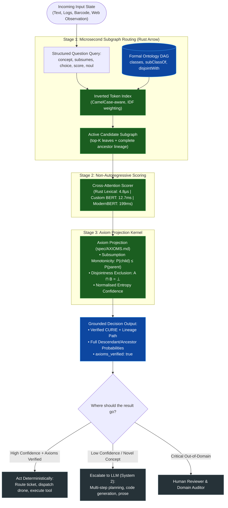

# What O-Laya Actually Is: An Ontology-Grounded System 1 Decision Model

*A parallel and architectural response to [What Laya Actually Is](https://relay.sparkrouter.com/ai--and--local-models/what-laya-actually-is).*



## The Non-Generative Decision Paradigm

In his recent piece, *What Laya Actually Is*, the author laid out an argument for non-generative classification:
> *"Laya is not a chatbot. It doesn’t write code or summarize text. It is a small local model that reads text and answers structured questions, returning probabilities instead of paragraphs."*

We agree with the fundamental premise. In modern agentic pipelines, calling an autoregressive 70B parameter LLM to emit 50 tokens of JSON just to route an incident ticket or check a binary guardrail is wasteful, slow, and non-deterministic.

**However, unconstrained classification models suffer from a fatal structural flaw: they view the world as flat lists of strings.**

When you ask a flat classifier to route between `"billing"`, `"refunds"`, and `"chargeback"`, the model treats those options as disjoint tokens floating in an unconstrained softmax pool. It has no mathematical awareness that a `Refund` *is a subclass of* `BillingIssue`, or that `HardwareFailure` is *mutually exclusive with* `SoftwareBug`. 

In real deployments, flat classifiers frequently assign:
$$P(\text{PostgreSQL Deadlock}) = 0.85 \quad \text{while} \quad P(\text{Database Issue}) = 0.40$$

This represents a **logical contradiction**. In formal logic, if an entity is a database deadlock, it is *by definition* a database issue. When probabilities violate the axioms of the domain, downstream pipelines break.

**O-Laya solves this by grounding decisions in formal ontology lattices.**

---

## What O-Laya Actually Is

O-Laya is an **ontology-grounded System 1 decision engine**. You provide:
1. **An Input State**: Raw text, JSON payloads, GTIN barcodes, or error traces.
2. **A Formal Ontology DAG**: Classes, `subClassOf` hierarchies, and `disjointWith` axioms (ingested from standard OWL/RDF, Turtle, GS1, Schema.org, or DOID).
3. **Structured Questions**: Formulated using 5 formal primitives.

In a single forward pass, O-Laya projects candidate scores through an axiom kernel ([`spec/AXIOMS.md`](https://github.com/josaum/olaya/blob/main/spec/AXIOMS.md)), guaranteeing that:
- **Subsumption Monotonicity holds**: $P(\text{child}) \le P(\text{parent})$ everywhere in the lattice.
- **Disjointness holds**: Mutually exclusive branches sum to at most 1.0.
- **Lineage is returned**: Decisions provide full explainability from the root category down to the specific leaf CURIE.
- **`axioms_verified` is computed**: Verified on the output tensor at runtime, never hard-coded.

---

## The 5 Question Primitives

While Laya provides 3 flat questions (`choice`, `score`, `noul`), O-Laya expands the decision algebra into **5 grounded primitives**:

### 1. `concept` (Hierarchical Taxonomy Grounding)
Grounds an observation into the most specific leaf concept under a designated ontology root:

```python
questions = {
    "triage": {
        "type": "concept",
        "root": "INCIDENT:ROOT",
        "instructions": "Classify the operational infrastructure failure."
    }
}
```

**What O-Laya returns:**
```json
{
  "triage": {
    "curie": "INCIDENT:DB_DEADLOCK",
    "lineage": ["INCIDENT:ROOT", "INCIDENT:STORAGE", "INCIDENT:DATABASE", "INCIDENT:DB_DEADLOCK"],
    "confidence": 0.892,
    "candidate_probabilities": {
      "INCIDENT:DB_DEADLOCK": 0.824,
      "INCIDENT:CONNECTION_POOL_EXHAUSTED": 0.116,
      "INCIDENT:DISK_FULL": 0.060
    },
    "probabilities": {
      "INCIDENT:ROOT": 1.0,
      "INCIDENT:STORAGE": 0.940,
      "INCIDENT:DATABASE": 0.940,
      "INCIDENT:DB_DEADLOCK": 0.824
    },
    "axioms_verified": true
  }
}
```
*Notice that the parent probabilities are derived directly from their descendant sum. The answer is never an illegal ancestor of a candidate, and monotonicity is preserved by construction.*

### 2. `subsumes` (Principal Down-Set Membership)
Tests whether the incoming observation belongs to the sub-tree rooted at concept $C$ ($\downarrow C$):

```python
questions = {
    "is_hardware": {
        "type": "subsumes",
        "concept": "INCIDENT:HARDWARE",
        "instructions": "Does this issue involve physical server hardware?"
    }
}
```

Returns the calibrated Bernoulli probability $P(\text{entity} \in \downarrow C)$. If the entity is a memory ECC fault, $P(\text{HARDWARE}) = 0.97$. If it is an invalid API key, $P(\text{HARDWARE}) = 0.01$.

### 3. `choice` (Disjoint Alternative Ranking)
Evaluates discrete alternatives with semantic criteria descriptions and formal mutual exclusion.

### 4. `score` (Ordered Metric Regression)
Predicts an ordered categorical scale (e.g., urgency, priority, or severity) with normalized softmax confidence.

### 5. `noul` (Out-of-Domain Rejection & Binary Guardrails)
Calibrated binary gating. In Python, returns $P(\text{true})$ for zero-shot hypothesis verification; in Node/TypeScript, acts as a certified out-of-domain rejection filter.

---

## Solving the Scalability Bottleneck: From 20 to 100,000+ Classes

A major limitation highlighted in the original Laya post is candidate scalability:
> *"Keep option lists short. Accuracy drops past roughly 20 options."*

When an enterprise ontology contains 5,000 product classes (GS1), 12,000 disease phenotypes (DOID), or 100,000 organizational concepts, feeding 100,000 options into a single transformer prompt is computationally impossible.

O-Laya solves this using a **Two-Tier Subgraph Routing Architecture**:

1. **Inverted Token Indexing with IDF Weighting (Sub-Microsecond)**:
   - Labels, synonyms, descriptions (`rdfs:comment`, `skos:definition`, `schema:description`) are indexed into an Arrow-native memory buffer.
   - Incoming state is tokenized with CamelCase awareness and scored in **4.8 microseconds**.
2. **Active Subgraph Extraction**:
   - The top-$K$ candidate leaves and their complete ancestor chains are extracted into an active sub-lattice.
3. **Cross-Encoder Scoring**:
   - The neural decision model only reasons over the active subgraph, allowing O-Laya to scale to **hundreds of thousands of classes** without degradation.

---

## Measured Performance & Hardware Benchmarks

All benchmarks measured on consumer hardware (Apple Silicon MPS / single CPU core) on real GS1 and Incident payloads:

| Runtime / Architecture | Parameters | Dimension & Depth | Median Latency | P95 Latency | Throughput | Role / Profile |
|---|---|---|---|---|---|---|
| **Rust Arrow Lexical** (`olaya-core`) | 0 (pure index) | Arrow IPC Buffer | **4.8 µs** | 5.2 µs | **~210,000 qps** | Microsecond inline routing |
| **Custom BERT Decision Model** | 15.37M | 4 layers, 256d | **12.71 ms** | **14.52 ms** | **231.7 qps** | Ultra-low latency local neural decisions |
| **ModernBERT-base Backbone** | 149.91M | 22 layers, 768d | **199.10 ms** | **217.52 ms** | **14.9 qps** | Deep semantic reasoning (100% GS1 accuracy) |
| **WebMCP Agent Bridge** (JSON-RPC) | N/A (RPC) | Custom BERT | **11.57 ms** | **12.83 ms** | **86.3 qps** | Model Context Protocol tool execution |

---

## The Zero-Install Agent Wedge: `olaya-mcp`

You don't need to write custom Python glue code to put O-Laya in front of your agents. O-Laya ships as a zero-install **Model Context Protocol (MCP 2024-11-05)** server.

### Run Instantly via uvx or npx

```bash
# Python runtime (PyPI / uvx)
uvx olaya-mcp

# Or zero-dependency Node/TypeScript runtime (npm / npx)
npx @mycelia/olaya-mcp
```

### Auto-Configure Claude Desktop or Cursor in 1 Second

```bash
# Automatically detects and configures Claude Desktop:
uvx olaya-mcp install --client claude

# Or Cursor IDE:
uvx olaya-mcp install --client cursor
```

### Instant CLI Grounding

```bash
# Fast sub-millisecond lexical grounding
olaya-mcp ground "Organic whole milk carton 1 gallon barcode 0614141000036" --domain gs1 --mode fast

# Neural cross-encoder grounding
olaya-mcp ground "Type 2 diabetes mellitus with diabetic nephropathy" --domain doid --mode neural
```

---

## Summary: When to Use What

| Task | Tool | Why |
|---|---|---|
| **Multi-step reasoning, coding, prose generation** | **LLM (Claude, GPT, Gemini)** | Expressive autoregressive generation |
| **Unstructured flat 3-way triage (<10 classes)** | **Laya** | Fast local classifier |
| **Hierarchical decisions, taxonomy grounding, GTIN/SKU routing, formal compliance, certified guardrails** | **O-Laya** | **Axiom-verified, $P(\text{child}) \le P(\text{parent})$, scales to 100k+ concepts, 4.8µs to 12ms latency, MCP-native** |

---

*Open Source Code & Benchmarks: [github.com/josaum/olaya](https://github.com/josaum/olaya)*
