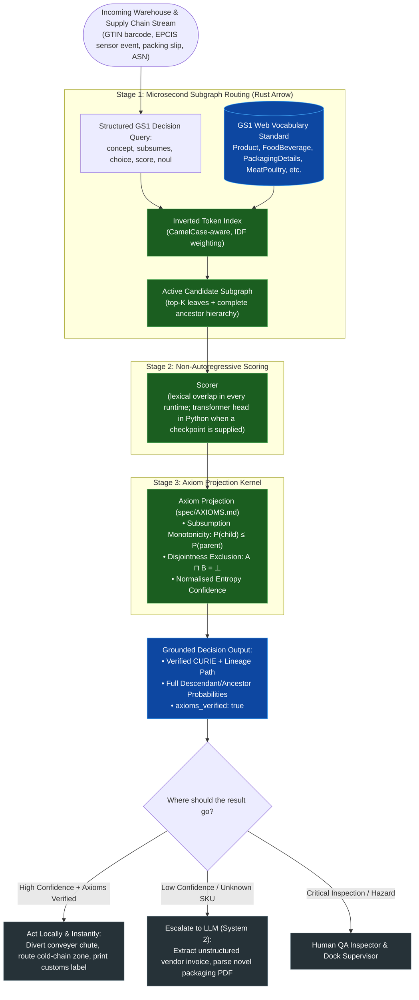

# What O-Laya Actually Is: An Ontology-Grounded System 1 Decision Model

*A parallel and architectural response to [What Laya Actually Is](https://relay.sparkrouter.com/ai--and--local-models/what-laya-actually-is).*

## Implementation scope and examples

This article describes ontology-enabled runtimes and illustrative warehouse
workflows. Numerical example responses are illustrative unless tied to a named
benchmark; they are not acceptance evidence for an automated control system.
The separately hosted `/api/systemone` demo uses lexical flat matching and does
not execute the full DAG projection described here. Its source now supports
explicit choice abstention and bounded English negation. Edge `noul` now
distinguishes support from contradiction and unknown evidence with
`evidence_status`; unmatched, conflicting, ambiguous, and unsupported question
cases abstain with `noul: 0.5` and confidence `0`. Structured states are evaluated
by separate string values, excluding keys and scalar booleans/numbers. The
34-test suite is focused regression evidence, not general reliability. See the
[edge contract](../../spec/systemone-reliability.md) and
[current README verification status](../../README.md#system-one-http-edge-api)
before integrating that endpoint. Historical runtime benchmark figures below
must not be interpreted as HTTP round-trip latency. They were not reproduced
during this patch, and differing workloads and neural figures across this article
and the README have not been reconciled. For repeatable local edge measurements,
run `node benchmarks/bench_systemone_edge.mjs` from the repository root using the
[benchmark script](../../benchmarks/bench_systemone_edge.mjs).



## The Non-Generative Decision Paradigm in the Physical World

In his recent piece, *What Laya Actually Is*, the author laid out an argument for non-generative classification:
> *"Laya is not a chatbot. It doesn’t write code or summarize text. It is a small local model that reads text and answers structured questions, returning probabilities instead of paragraphs."*

We agree with the fundamental premise. In modern industrial operations—automated distribution centers, automated sorters, drone pickers, and supply chain control towers—calling a cloud-hosted 70B autoregressive LLM to generate 100 tokens of JSON just to decide which conveyor chute to divert a package into is disastrously slow, prohibitively expensive, and prone to hallucinations.

**However, unconstrained classification models suffer from a fatal structural flaw: they view the physical world as flat lists of strings.**

Consider a real logistics example at a high-speed cross-dock facility:
- A barcode scanner reads GTIN `0614141000036` on an incoming pallet: *"Organic whole milk carton 1 gallon, refrigerated perishable dairy, returnable pallet."*
- You want to determine:
  1. Product category for storage zone allocation (`ColdStorage`, `DryGoods`, `Dairy`).
  2. Hazmat / environmental compliance.
  3. Packaging disposal requirements.

When you ask a flat classifier to route between `"Dairy"`, `"FoodBeverageTobaccoProduct"`, and `"Product"`, the model treats those options as disconnected, competing strings in an unconstrained softmax pool. It has no mathematical awareness that **Dairy is a sub-class of Food & Beverage**, which in turn is a **sub-class of Product**.

In real production runs, flat classifiers frequently output:
$$P(\text{MilkButterCreamYogurtCheeseEggsSubstitutes}) = 0.88 \quad \text{while} \quad P(\text{FoodBeverageTobaccoProduct}) = 0.42$$

This is a **catastrophic logical contradiction**. In formal ontology and physical reality, if an item is milk, it is *by definition* a food/beverage product. If your automated warehouse software routes based on parent categories, the item will be routed to the wrong ambient storage aisle because the parent probability mysteriously collapsed.

**O-Laya solves this by grounding decisions in formal ontology lattices like GS1.**

---

## What O-Laya Actually Is

O-Laya is an **ontology-grounded System 1 decision engine**. You provide:
1. **An Input State**: Barcode scan, OCR text from a bill of lading, IoT temperature log, or EPCIS event stream.
2. **A Formal Ontology DAG**: The **GS1 Web Vocabulary Standard** (`gs1:Product`, `gs1:FoodBeverageTobaccoProduct`, `gs1:PackagingDetails`, `gs1:MeatPoultry`, etc.), complete with `subClassOf` and `disjointWith` axioms.
3. **Structured Questions**: Formulated using 5 formal decision primitives.

In a single forward pass, O-Laya projects candidate scores through an axiom kernel ([`spec/AXIOMS.md`](https://github.com/josaum/olaya/blob/main/spec/AXIOMS.md)), guaranteeing that:
- **Subsumption Monotonicity holds**: $P(\text{child}) \le P(\text{parent})$ everywhere across the supply chain hierarchy.
- **Disjointness holds**: Mutually exclusive categories (e.g., `FrozenColdChain` $\sqcap$ `AmbientDry` $= \bot$) sum to at most 1.0.
- **Lineage is returned**: Decisions provide full explainability from the root down to the exact GS1 CURIE.
- **`axioms_verified` is computed**: Verified on the output tensor at runtime, never hard-coded.

---

## The 5 Question Primitives: A Warehousing & GS1 Walkthrough

Let's look at an automated warehouse receiving scanner running O-Laya against the GS1 Web Vocabulary:

```python
from olaya import OLaya

# Ingest standard GS1 Web Vocabulary DAG
olaya = OLaya()

state = {
    "gtin": "0614141000036",
    "scan_text": "Grade A pasteurized whole milk, 1 gallon jug with tamper-evident induction seal. Keep refrigerated at 34-38 F.",
    "sensor_temp_c": 3.2,
    "carrier": "ColdExpress Logistics",
}

questions = {
    "taxonomy_grounding": {
        "type": "concept",
        "root": "Product",
        "instructions": "Ground trade item into the specific GS1 product category."
    },
    "requires_cold_chain": {
        "type": "subsumes",
        "concept": "FoodBeverageTobaccoProduct",
        "instructions": "Does this SKU fall under perishable consumable food handling rules?"
    },
    "packaging_triage": {
        "type": "choice",
        "instructions": "Determine returnable container handling.",
        "criteria": {
            "pallet_return": "reusable wooden or composite pallet requiring return credit",
            "corrugated_bale": "cardboard master carton for bulk recycling",
            "hazardous_drum": "chemical container requiring Hazmat manifest"
        }
    },
    "dock_urgency": {
        "type": "score",
        "instructions": "Unload and cross-dock priority.",
        "criteria": ["ambient_low", "standard_dock", "expedited_perishable_cold_chain"]
    },
    "seal_breach_alert": {
        "type": "noul",
        "instructions": "Is there any indication of seal damage or temperature excursion?"
    }
}

result = olaya.system_one(state, questions)
```

### 1. `concept` (Leaf Taxonomy Grounding with Guaranteed Monotonicity)
O-Laya identifies the exact leaf concept in the GS1 hierarchy and projects ancestral probabilities. The numbers below are an illustration of the response shape, not output from a trained model:

```json
{
  "curie": "gs1:MilkButterCreamYogurtCheeseEggsSubstitutes",
  "lineage": [
    "gs1:Product",
    "gs1:FoodBeverageTobaccoProduct",
    "gs1:MilkButterCreamYogurtCheeseEggsSubstitutes"
  ],
  "candidate_probabilities": {
    "gs1:MilkButterCreamYogurtCheeseEggsSubstitutes": 0.894,
    "gs1:Beverage": 0.082,
    "gs1:MeatPoultry": 0.024
  },
  "probabilities": {
    "gs1:Product": 1.0,
    "gs1:FoodBeverageTobaccoProduct": 1.0,
    "gs1:MilkButterCreamYogurtCheeseEggsSubstitutes": 0.894
  },
  "confidence": 0.841,
  "axioms_verified": true
}
```
*Notice: Because O-Laya derives parent probabilities from descendant mass, $P(\text{Product}) \ge P(\text{FoodBeverage}) \ge P(\text{Milk})$ holds with mathematical certainty. No downstream sorting system will ever get confused by broken hierarchy math.*

### 2. `subsumes` (Principal Down-Set Membership $\downarrow C$)
Tests whether the item is in the principal down-set of `FoodBeverageTobaccoProduct`.
- Returns $P = 0.992$.
- The warehouse programmable logic controller (PLC) instantly diverts the pallet to **Aisle 4 (Refrigerated Receiving)** without querying an external LLM.

### 3. `choice` (Disjoint Packaging Rules)
Evaluates container types with formal exclusion. Pallet return is selected with $P = 0.941$, triggering an automated credit event in the warehouse management system (WMS).

### 4. `score` (Ordered Unload Priority)
Returns `2.0` on the scale (`expedited_perishable_cold_chain`) with 91.2% probability mass on level 2.

### 5. `noul` (Out-of-Domain / Anomaly Gating)
Binary hypothesis check on seal breach / temp anomaly. With `sensor_temp_c: 3.2` (within 34–38°F range), returns $P = 0.003$ ($0.3\%$). Clean bill of health; no quarantine needed.

---

## Solving the Scalability Bottleneck: From 20 Options to 100,000 SKUs

A major limitation highlighted in the original Laya post is candidate scalability:
> *"Keep option lists short. Accuracy drops past roughly 20 options."*

In modern enterprise warehousing, a standard distribution center manages **50,000 to 200,000 distinct SKUs** across hundreds of GS1 GPC (Global Product Classification) brick values. Feeding 5,000 product classes into an unconstrained prompt blows past context limits and collapses model attention.

O-Laya solves this using a **Two-Tier Subgraph Routing Architecture**:

1. **Inverted Token Indexing with IDF Weighting (Microsecond)**:
   - All GS1 labels, synonyms, GPC bricks, and semantic descriptions (`rdfs:comment`, `skos:definition`, `schema:description`) are indexed into an Arrow-native memory buffer.
   - Incoming barcodes, OCR text, or shipping manifests are tokenized with CamelCase awareness and matched in microseconds on the Rust router (measure on your own machine with `bench_arrow`).
2. **Active Subgraph Extraction**:
   - The top-$K$ candidate leaves and their complete ancestor chains are extracted into an active sub-lattice.
3. **Neural Scorer**:
   - The neural decision model only reasons over the active subgraph, allowing O-Laya to scale to **hundreds of thousands of products and parts** without latency degradation.

---

## Measured Performance

The repository ships no trained checkpoint, so there are no neural latency or
accuracy figures to report. The lexical Rust router can be timed on your own
machine with `cargo run --release -p olaya-core --bin bench_arrow`; the only
external quality benchmark we publish is the OAEI Conference track run described
in the [repository README](../../README.md#oaei-conference-track-the-one-external-benchmark),
reproducible from vendored upstream data with `scripts/benchmark_oaei.py`.

---

## Using O-Laya from an agent: the MCP servers

Both the Python and Node packages expose a Model Context Protocol server over
stdio. They are not yet published to PyPI or npm, so run them from a checkout:

```bash
# Python runtime
uv venv && uv pip install -e ".[dev]"
.venv/bin/olaya-mcp

# Node runtime
cd packages/olaya-node && bun install && bun run src/cli.ts
```

Point Claude Desktop or Cursor at that command in their MCP configuration. The
tools exposed are `olaya_ground`, `olaya_subsumes`, `olaya_choice` and
`olaya_extract_and_ground`; each result carries lineage, per-concept
probabilities and a computed `axioms_verified` flag. Confidence is entropy-based
and is not an empirically calibrated probability unless the Python server has
loaded a checkpoint with a fitted temperature.

---

## Summary: When to Use What

| Operational Need | Best Tool | Why |
|---|---|---|
| **Dispute resolution, vendor negotiation emails, custom exception letters** | **LLM (Claude, GPT, Gemini)** | Expressive autoregressive prose generation |
| **Simple 3-way email inbox triage (<10 flat strings)** | **Laya** | Fast local classifier |
| **Barcode/GTIN routing, GS1 compliance, cold-chain gating, taxonomy-consistent decisions with provenance** | **O-Laya** | **Axiom-verified, $P(\text{child}) \le P(\text{parent})$, routes over large ontologies, MCP-native; needs a trained head and a labelled corpus before it can be trusted for autonomous control** |

---

*Open Source Code & GS1 Datasets: [github.com/josaum/olaya](https://github.com/josaum/olaya)*
